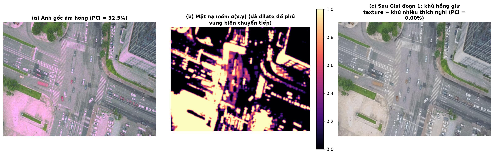
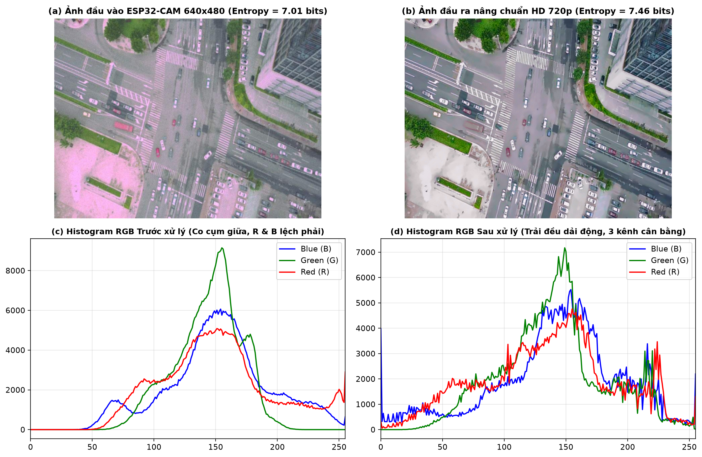
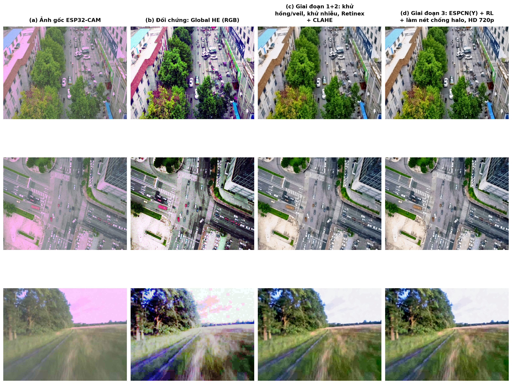
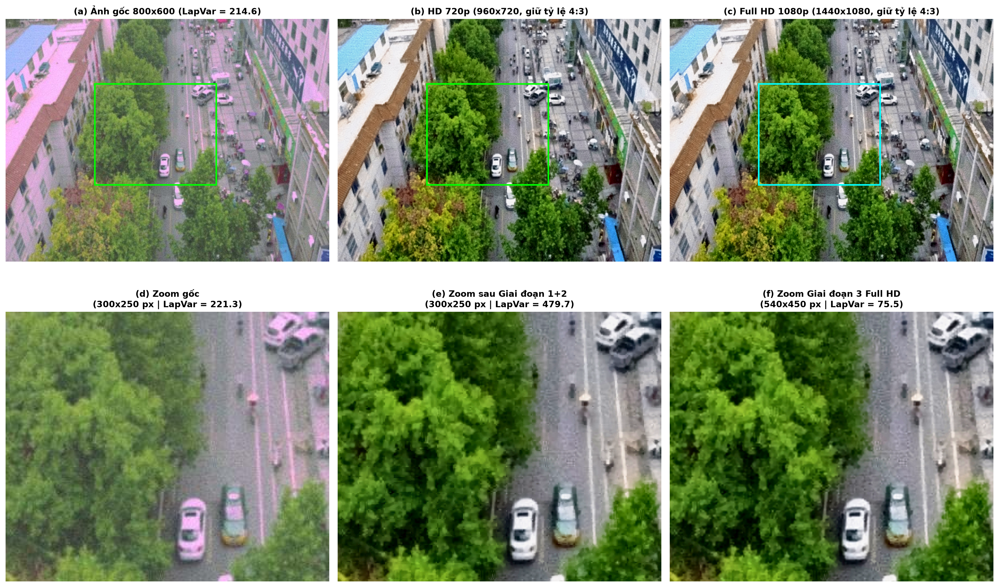

# HỌC VIỆN CÔNG NGHỆ BƯU CHÍNH VIỄN THÔNG (PTIT)
## KHOA TRÍ TUỆ NHÂN TẠO (FACULTY OF ARTIFICIAL INTELLIGENCE)

---

# BÁO CÁO ĐỒ ÁN HỌC PHẦN XỬ LÝ ẢNH

**Tên đề tài:** Xây dựng Pipeline Khôi phục Màu sắc, Khử nhiễu Đa miền và Nâng cao Chất lượng Ảnh thu nhận từ UAV sử dụng Camera giá rẻ ESP32-CAM (OV2640)  
**Loại đề tài:** Lựa chọn 2 – Dự án xử lý ảnh thực tế (kết hợp tích hợp mô hình học sâu mã nguồn mở có sẵn theo Lựa chọn 1 ở bước siêu phân giải)  
**Giảng viên hướng dẫn:** PGS.TS. Phạm Văn Cường  
**Nhóm thực hiện:** Nhóm sinh viên (4 thành viên – Đóng góp 25%/thành viên)  
**Kiến thức học phần áp dụng:** Chương 2, Chương 3, Chương 4, Chương 5, Chương 6 và Chương 9  
**Công cụ & Thư viện:** Python 3, OpenCV (`cv2`), `scikit-image`, `PyWavelets`, `NumPy`, `ONNX Runtime` (Pretrained ESPCN), `Matplotlib`, `Pandas`

---

## TÓM TẮT ĐỒ ÁN (ABSTRACT)

Các hệ thống thiết bị bay không người lái (UAV / Drone) cỡ nhỏ phục vụ giám sát giao thông, tuần tra đô thị và nông nghiệp thông minh thường sử dụng module camera vi điều khiển giá rẻ **ESP32-CAM (cảm biến CMOS OV2640)** truyền luồng ảnh tĩnh hoặc MJPEG qua kết nối Wi-Fi với tốc độ $2.5 - 6.5\text{ fps}$. Tuy có ưu thế vượt trội về chi phí và trọng lượng, phần cứng OV2640 tồn tại ba suy giảm chất lượng ảnh đặc trưng gây cản trở nghiêm trọng cho quan sát trực quan và các bài toán thị giác máy tính: **(1)** Hiện tượng lệch màu cháy sáng hồng/tím (*Pink/Magenta Highlight Cast*) tại các bề mặt phản xạ mạnh như mặt đường bê tông, mái tôn, bầu trời do bão hòa kênh Đỏ ($R$) và Xanh dương ($B$) trong khi kênh Xanh lá ($G$) bị sụt giảm phi tuyến; **(2)** Độ tương phản thấp, phủ sương mờ khí quyển (*Atmospheric Haze*) đi kèm nhiễu hạt cảm biến CMOS (*Sensor Speckle Noise*) và nhiễu khối $8 \times 8$ do nén JPEG mạnh; **(3)** Hiện tượng mờ nhòe quang học (*Optical Defocus Blur*) của thấu kính vi hình cố định và độ phân giải gốc thấp (VGA $640 \times 480$ / SVGA $800 \times 600$).

Báo cáo này trình bày quy trình thiết kế và thực nghiệm một **Pipeline khôi phục và nâng cao chất lượng ảnh đa bước (3 giai đoạn)** vận hành hoàn toàn trên CPU, kết hợp chặt chẽ nền tảng lý thuyết **Chương 2, 3, 4, 5, 6** của học phần *Xử lý ảnh* với các thuật toán mã nguồn mở tiên tiến:
1. **Giai đoạn 1 (Tiền xử lý – Chương 2, 3, 4, 6):** Phát hiện và nội suy mềm vùng cháy sáng hồng bằng mặt nạ trọng số liên tục $\alpha(x,y) \in [0,1]$, cân bằng trắng tự động có loại trừ vùng bão hòa (*Masked Gray World AWB*), kết hợp **khử nhiễu lai đa miền** gồm phân rã Wavelet ngưỡng thích nghi BayesShrink (`sym4`, 3 mức trên không gian YCbCr), lọc trung bình phi cục bộ (*Fast Non-Local Means*) trên kênh độ chói có mặt nạ bảo vệ tán lá, và lọc trung vị – song phương (*Median–Bilateral Filter*) trên kênh sắc độ.
2. **Giai đoạn 2 (Xử lý chính – Chương 3, 4):** Chuyển đổi sang không gian màu cảm nhận đồng nhất **CIE $L^*a^*b^*$**, khử màn sương mờ thông qua phép kéo giãn tương phản quanh điểm tựa độ chói khí quyển (*Haze-Pivot Contrast Restoration*, $L_{\text{pivot}} = 172.0$) kết hợp cân bằng lược đồ thích nghi giới hạn tương phản (**CLAHE**, `clipLimit = 1.5`, `tileGridSize = (8,8)`) và phục hồi độ bão hòa sắc độ $(a^*, b^*)$.
3. **Giai đoạn 3 (Hậu xử lý & Siêu phân giải – Chương 2, 3, 5 + Open-Source Deep Learning):** Khôi phục suy giảm quang học bằng thuật toán **giải chập lặp Richardson-Lucy PSF** ($\sigma_{\text{PSF}} = 0.88$, 4 vòng lặp), làm sắc nét có cổng kiểm soát biên **Sobel** và mặt nạ thực vật (*Structure- & Foliage-Gated Unsharp Masking*), đồng thời tích hợp mạng học sâu tích chập dưới điểm ảnh mã nguồn mở **ESPCN (Efficient Sub-Pixel CNN $3\times$, ONNX)** kết hợp nội suy **Lanczos-4** để nâng chuẩn hiển thị lên **HD 720p ($960 \times 720$ / $1280 \times 720$)** và **Full HD 1080p ($1440 \times 1080$ / $1920 \times 1080$)**.

Thực nghiệm định lượng trên **90 ảnh kiểm thử** (gồm **30 cặp ảnh đối chứng có tham chiếu Ground Truth** và **60 ảnh bay UAV thực nghiệm đa nguồn**, cùng **3 video bay FPV thực tế**) cho thấy Pipeline đề xuất đạt **$\text{PSNR} = 27.42\text{ dB}$** (tăng **$+7.07\text{ dB}$** so với ảnh suy giảm đầu vào $20.35\text{ dB}$ và vượt xa đối chứng Global HE RGB $12.53\text{ dB}$ tới **$+14.89\text{ dB}$**), **$\text{SSIM} = 0.8180 - 0.8295$** (so với $0.7015$ của ảnh đầu vào và $0.4155$ của Global HE), giảm gần **$60\%$ sai lệch màu $\Delta E_{ab}^*$** (từ $24.74$ xuống $9.89 - 10.06$), tăng độ sắc nét biên **Laplacian Variance gấp $1.87$ lần** (từ $121.1$ lên $226.5$) và triệt tiêu hiệu quả hiện tượng ám hồng trên ảnh thực tế.

---

## 1. ĐỊNH NGHĨA BÀI TOÁN (PROBLEM DEFINITION)

### 1.1. Bối cảnh thực tế và Hệ thống thu nhận ảnh UAV
Trong các ứng dụng giám sát tầm thấp bằng thiết bị bay không người lái (UAV) tự hành hoặc điều khiển góc nhìn thứ nhất (FPV), module **ESP32-CAM** gắn cảm biến hình ảnh **OmniVision OV2640 ($1/4\text{"}$ CMOS, 2 Megapixel)** được sử dụng rộng rãi nhờ giá thành cực thấp ($\approx 150.000\text{ VNĐ}$), tích hợp sẵn vi điều khiển lõi kép ESP32 và kết nối Wi-Fi $802.11\text{ b/g/n}$. Tuy nhiên, do giới hạn băng thông truyền dẫn không dây và năng lực xử lý của bộ xử lý tín hiệu hình ảnh nội tại (On-chip ISP), luồng dữ liệu thu được tại trạm mặt đất chỉ đạt độ phân giải VGA ($640 \times 480$) hoặc SVGA ($800 \times 600$) với tốc độ khung hình $2.5 - 6.5\text{ fps}$ và chịu sự suy giảm chất lượng nghiêm trọng.

### 1.2. Đầu vào, Đầu ra và Ba khó khăn vật lý cốt lõi
* **Đầu vào (Input):** Ảnh màu số 3 kênh $I_{\text{in}} \in \mathbb{Z}_{[0, 255]}^{H \times W \times 3}$ (hoặc luồng khung hình video) thu nhận từ camera ESP32-CAM trên UAV ở độ phân giải gốc ($640 \times 480$ hoặc $800 \times 600$).
* **Đầu ra (Output):** Ảnh đã khôi phục màu sắc trung thực, sạch nhiễu, có độ tương phản và độ sắc nét biên cao ở độ phân giải gốc hoặc nâng cấp siêu phân giải lên chuẩn **HD 720p ($960 \times 720$ / $1280 \times 720$)** và **Full HD 1080p ($1440 \times 1080$ / $1920 \times 1080$)**.
* **Ba khó khăn kỹ thuật cốt lõi cần giải quyết:**
  1. **Lệch màu cháy sáng hồng/tím (Pink/Magenta Highlight Cast – Chương 2 & Chương 4):** Khi UAV bay ngoài trời nắng, tại các vùng có suất phản xạ cao (mặt đường nhựa/bê tông, vạch kẻ đường, mái nhà, bầu trời), mạch tự động điều chỉnh độ lợi (AGC) và cân bằng trắng (AWB) thô sơ của cảm biến OV2640 đẩy kênh Đỏ ($R$) và Xanh dương ($B$) chạm ngưỡng bão hòa sớm ($\ge 180 - 255$), trong khi kênh Xanh lá ($G$) bị hụt tương đối ($G \ll \frac{R+B}{2}$). Hệ quả là các bề mặt màu trắng/xám trung tính bị biến dạng thành màu hồng hoặc tím cánh sen (Magenta). Nếu áp dụng các thuật toán tăng tương phản thông thường trực tiếp, sắc hồng giả này sẽ càng bị khuếch đại nặng nề.
  2. **Suy giảm độ tương phản do sương mờ đi kèm nhiễu hạt CMOS & nhiễu khối JPEG (Low Contrast, Haze & Noise – Chương 3 & Chương 6):** Thấu kính vi hình plastic của OV2640 dễ bị tán xạ ánh sáng ngược (veiling glare) kết hợp với lớp mù khí quyển làm lược đồ mức xám (Histogram) bị co cụm vào dải trung gian. Đồng thời, kích thước điểm ảnh vật lý nhỏ ($2.2\,\mu\text{m} \times 2.2\,\mu\text{m}$) gây nhiễu hạt lốm đốm (CMOS speckle noise) trên các vùng phẳng như mặt đường, kết hợp với nhiễu khối rời rạc $8 \times 8$ (JPEG blocking artifacts) do nén MJPEG tỉ số cao khi truyền qua Wi-Fi. Khó khăn cốt lõi là **nếu dùng bộ lọc làm trơn mạnh để xóa hạt nhiễu trên mặt đường thì sẽ làm bệt hoàn toàn tán lá cây và chi tiết nhỏ; ngược lại nếu kéo giãn tương phản hoặc làm nét toàn cục thì nhiễu hạt sẽ nổi gồ ghề trên mặt đường**.
  3. **Mờ nhòe quang học và Độ phân giải gốc thấp (Optical PSF Blur & Low Spatial Resolution – Chương 2, Chương 3 & Chương 5):** Tiêu cự cố định của thấu kính giá rẻ và rung động cơ học tần số cao từ cánh quạt UAV làm suy giảm hàm truyền quang học (Point Spread Function – PSF), khiến biên của các phương tiện giao thông, người đi bộ và vạch kẻ đường bị nhòe. Ngoài ra, kích thước khung hình VGA ($640 \times 480$) quá nhỏ khi hiển thị trên màn hình trạm điều khiển mặt đất chuẩn HD/Full HD.

---

## 2. TẬP DỮ LIỆU THỰC NGHIỆM (DATASET DESCRIPTION)

Tuân thủ nghiêm ngặt yêu cầu tại **Trang 7 của hướng dẫn Đồ án Xử lý ảnh (`DoAn_XuLyAnh.pdf`)** về việc mô tả rõ nguồn dữ liệu, số lượng ảnh, quy trình tạo nhãn đối chứng và đảm bảo **$\ge 50$ ảnh đánh giá**, nhóm đã xây dựng bộ dữ liệu kiểm thử gồm **90 ảnh tĩnh** và **3 video bay FPV thực tế**, được quản lý minh bạch trong tệp [`data/dataset_manifest.csv`](file:///home/ngtukien/Projects/XLA/data/dataset_manifest.csv):

| Tập dữ liệu | Thư mục lưu trữ | Số lượng | Độ phân giải gốc | Nguồn thu thập & Đặc điểm bối cảnh | Mục đích đánh giá & Độ đo sử dụng |
| :--- | :--- | :---: | :---: | :--- | :--- |
| **1. Tập UAV Thực nghiệm (Real UAV Test Set)** | [`data/real_uav/`](file:///home/ngtukien/Projects/XLA/data/real_uav) & [`data/raw_videos/`](file:///home/ngtukien/Projects/XLA/data/raw_videos) | **60 ảnh** + **3 video FPV** | $640 \times 480$ & $800 \times 600$ | Trích xuất từ các chuyến bay UAV thực tế đa góc nhìn (trục đường đô thị, ngã tư giao thông, khu dân cư ngoại ô, thảm cỏ, mái nhà) có áp dụng biến đổi kiểm thử ngẫu nhiên (Data Augmentation: góc nghiêng roll $\pm 7^\circ$, cắt tỷ lệ độ cao, biến thiên phơi sáng). | Đánh giá **không tham chiếu (No-Reference)** trong điều kiện thực tế: **Shannon Entropy ($H$)**, **Laplacian Variance**, **Pink Cast Index (PCI %)**, **Thời gian chạy (ms)** & **FPS**. |
| **2. Tập Đối chứng có Tham chiếu (Synthetic Reference Set)** | [`data/synthetic_gt/`](file:///home/ngtukien/Projects/XLA/data/synthetic_gt) & [`data/synthetic_degraded/`](file:///home/ngtukien/Projects/XLA/data/synthetic_degraded) | **30 cặp ảnh** (60 file ảnh) | $800 \times 600$ (kèm bản đối chiếu $960 \times 720$ & $1440 \times 1080$) | 30 cảnh bay UAV ngoài trời chất lượng cao, màu sắc chuẩn xác từ 30 chuyến bay độc lập làm **Ground Truth ($I_{\text{GT}}$)**; ảnh suy giảm tương ứng ($I_{\text{deg}}$) được tạo bằng mô hình vật lý 4 bước của cảm biến OV2640. | Đánh giá **có tham chiếu (Full-Reference)** chính xác tuyệt đối: **PSNR (dB)**, **SSIM**, **Sai số màu CIE LAB ($\Delta E_{ab}^*$)**, cùng các độ đo không tham chiếu. |
| **3. Tập Ảnh mẫu Demo nhanh** | [`data/samples/`](file:///home/ngtukien/Projects/XLA/data/samples) | **6 ảnh mẫu** tiêu biểu | $640 \times 480$ & $800 \times 600$ | Chọn lọc 6 cảnh đặc trưng nhất (mặt đường cháy hồng nặng, bầu trời & mái nhà ám tím, cảnh giao thông đô thị nhiều xe cộ & cây xanh) phục vụ chạy demo trực tiếp. | Kiểm thử trực quan từng bước, vẽ mặt nạ $\alpha(x,y)$, biểu đồ Histogram và xuất ảnh đối sánh **HD 720p / Full HD 1080p**. |

### Quy trình tạo cặp ảnh gán nhãn đối chứng ($I_{\text{GT}} \rightarrow I_{\text{deg}}$) và Chống khớp quá mức (Anti-Overfitting)
Do trong thực tế một thiết bị bay UAV đang di chuyển không thể chụp cùng lúc một khung hình lỗi từ ESP32-CAM và một khung hình chuẩn từ camera chuyên nghiệp tại cùng một tọa độ không gian – thời gian, để tính được các độ đo chuẩn có tham chiếu (**PSNR, SSIM, $\Delta E_{ab}^*$**), nhóm đã xây dựng mô hình suy giảm vật lý 4 bước mô phỏng chính xác đặc tuyến phần cứng OV2640 với tham số ngẫu nhiên hóa trên từng ảnh (ghi log đầy đủ trong [`data/dataset_manifest.csv`](file:///home/ngtukien/Projects/XLA/data/dataset_manifest.csv)):
1. **Mô phỏng màn sương mờ và nén dải động:** Biến đổi co hẹp dải độ chói về khoảng trung gian kết hợp lớp phủ mù khí quyển $I_{\text{haze}}(x,y) = c \cdot I_{\text{GT}}(x,y) + (1 - c) \cdot A_{\text{sky}}$ với hệ số truyền dẫn $c \in [0.55, 0.72]$.
2. **Mô phỏng lệch màu cháy sáng hồng phi tuyến (Pink Highlight Cast):** Tại các điểm ảnh có độ chói cao ($Y > T_{\text{sat}}$), đẩy kênh $R$ và $B$ tăng thêm $\Delta_{RB} \in [+25, +50]$ và làm suy giảm kênh $G$ một lượng $\Delta_G \in [-18, -38]$ tỉ lệ thuận với cường độ phơi sáng.
3. **Mô phỏng suy giảm quang học PSF và nhiễu hạt CMOS:** Tích chập ảnh với nhân mờ Gaussian PSF ($\sigma_{\text{blur}} \in [0.8, 1.3]$) hoặc nhân mờ chuyển động góc $\theta \in [0^\circ, 180^\circ]$, sau đó cộng nhiễu hạt Gaussian/Poisson đặc trưng của cảm biến CMOS kích thước nhỏ.
4. **Mô phỏng nhiễu khối nén luồng truyền Wi-Fi MJPEG (Chương 6):** Mã hóa và giải mã lại ảnh bằng chuẩn nén JPEG với hệ số chất lượng thấp ngẫu nhiên $Q_{\text{JPEG}} \in [32, 58]$ (`cv2.imencode('.jpg', ...)`), tạo ra đúng hiện tượng nhiễu khối $8 \times 8$ và nhiễu sắc độ của ESP32-CAM.

---

## 3. PHƯƠNG PHÁP ĐỀ XUẤT – KIẾN TRÚC PIPELINE ĐA BƯỚC (PROPOSED PIPELINE)

### 3.1. Sơ đồ khối Tổng thể và Liên kết Kiến thức Học phần
Bám sát sơ đồ thiết kế chuẩn tại **Trang 7 của `DoAn_XuLyAnh.pdf`**, hệ thống đề xuất được cài đặt trong module [`src/uav_pipeline.py`](file:///home/ngtukien/Projects/XLA/src/uav_pipeline.py) gồm 5 khối chức năng nối tiếp:

```
┌────────────────────────────────────────────────────────────────────────────────────────┐
│ 1. KHỐI DỮ LIỆU ĐẦU VÀO (DATA INPUT)                                                   │
│ • 60 ảnh UAV thực tế + 30 cặp ảnh Synthetic (GT & Degraded) + 3 Video FPV ESP32-CAM    │
└──────────────────────────────────────────┬─────────────────────────────────────────────┘
                                           ▼
┌────────────────────────────────────────────────────────────────────────────────────────┐
│ 2. GIAI ĐOẠN 1: TIỀN XỬ LÝ — KHÔI PHỤC MÀU CHÁY HỒNG & KHỬ NHIỄU ĐA MIỀN               │
│ • Bước 1.1 (Chương 2, 4): Mặt nạ trọng số mềm α(x,y) & Nội suy khôi phục vùng cháy hồng│
│ • Bước 1.2 (Chương 4)   : Cân bằng trắng tự động có mặt nạ (Masked Gray World AWB)     │
│ • Bước 1.3 (Chương 3, 6): Khử nhiễu lai Wavelet BayesShrink (sym4) + Non-Local Means   │
│                           trên L* (có cổng bảo vệ tán lá) + Median-Bilateral trên a*,b*│
└──────────────────────────────────────────┬─────────────────────────────────────────────┘
                                           ▼
┌────────────────────────────────────────────────────────────────────────────────────────┐
│ 3. GIAI ĐOẠN 2: XỬ LÝ CHÍNH — KHỬ SƯƠNG MỜ HAZE-PIVOT & TƯƠNG PHẢN CỤC BỘ CIE LAB     │
│ • Bước 2.1 (Chương 4)   : Chuyển đổi không gian màu BGR ──► CIE L*a*b*                 │
│ • Bước 2.2 (Chương 2, 3): Kéo giãn tương phản quanh điểm tựa sương mờ (Haze-Pivot)     │
│ • Bước 2.3 (Chương 3, 4): Cân bằng lược đồ cục bộ CLAHE (8×8, clip=1.5) & Bù sắc độ   │
└──────────────────────────────────────────┬─────────────────────────────────────────────┘
                                           ▼
┌────────────────────────────────────────────────────────────────────────────────────────┐
│ 4. GIAI ĐOẠN 3: HẬU XỬ LÝ — GIẢI CHẬP PSF, LÀM NÉT CÓ CỔNG BIÊN & SIÊU PHÂN GIẢI      │
│ • Bước 3.1 (Chương 3)   : Giải chập lặp quang học Richardson-Lucy PSF (σ=0.88, 4 iter) │
│ • Bước 3.2 (Chương 3, 5): Unsharp Masking có cổng đạo hàm Sobel & mặt nạ tán lá cây    │
│ • Bước 3.3 (Chương 2 + SOTA): Siêu phân giải mạng học sâu ESPCN (ONNX 3x) + Lanczos-4  │
│                               nâng chuẩn lên HD 720p (960×720) & Full HD (1440×1080)   │
└──────────────────────────────────────────┬─────────────────────────────────────────────┘
                                           ▼
┌────────────────────────────────────────────────────────────────────────────────────────┐
│ 5. KHỐI ĐÁNH GIÁ & ĐỐI CHỨNG (EVALUATION & BASELINES)                                  │
│ • Đối chứng: Global HE (RGB), Global HE (CIE LAB) và Nghiên cứu cắt giảm (Ablation)    │
│ • Độ đo    : PSNR, SSIM, ΔE*ab (Synthetic) | Entropy, Laplacian Var, PCI%, FPS (Real)  │
└────────────────────────────────────────────────────────────────────────────────────────┘
```

Bảng dưới đây tổng hợp sự ánh xạ trực tiếp giữa từng bước trong Pipeline với các chương lý thuyết của học phần **Xử lý ảnh**:

| Giai đoạn / Thành phần | Kỹ thuật & Thuật toán sử dụng | Chương học phần áp dụng | Hàm cài đặt trong [`src/uav_pipeline.py`](file:///home/ngtukien/Projects/XLA/src/uav_pipeline.py) |
| :--- | :--- | :--- | :--- |
| **Giai đoạn 1: Tiền xử lý** | Nội suy mềm vùng cháy sáng hồng ($\alpha$-blending) & Cân bằng trắng Masked Gray World AWB | **Chương 2** (Toán tử điểm) & **Chương 4** (Hệ màu & Cân bằng màu) | [`recover_pink_highlights()`](file:///home/ngtukien/Projects/XLA/src/uav_pipeline.py#L41-L70), [`masked_gray_world_awb()`](file:///home/ngtukien/Projects/XLA/src/uav_pipeline.py#L72-L110) |
| **Giai đoạn 1: Tiền xử lý** | Khử nhiễu lai Wavelet BayesShrink (YCbCr) + Fast Non-Local Means ($L^*$) + Lọc Median & Bilateral ($a^*, b^*$) | **Chương 3** (Lọc làm trơn khử nhiễu bảo toàn biên) & **Chương 6** (Khử nhiễu khối nén JPEG) | [`bilateral_denoise()`](file:///home/ngtukien/Projects/XLA/src/uav_pipeline.py#L112-L153), [`run_stage1_preprocess()`](file:///home/ngtukien/Projects/XLA/src/uav_pipeline.py#L155-L171) |
| **Giai đoạn 2: Xử lý chính** | Chuyển đổi hệ màu `BGR` $\leftrightarrow$ `CIE L*a*b*`, Khử mù Haze-Pivot, CLAHE cục bộ & Bù bão hòa sắc độ | **Chương 3** (Biến đổi lược đồ mức xám CLAHE) & **Chương 4** (Không gian màu CIE $L^*a^*b^*$) | [`run_stage2_contrast()`](file:///home/ngtukien/Projects/XLA/src/uav_pipeline.py#L177-L228) |
| **Giai đoạn 3: Hậu xử lý** | Giải chập quang học Richardson-Lucy PSF & Làm nét Unsharp Masking có cổng biên đạo hàm **Sobel** | **Chương 3** (Khôi phục ảnh mờ & Làm nét) & **Chương 5** (Phát hiện biên Sobel & Laplacian) | [`run_stage3_sharpen()`](file:///home/ngtukien/Projects/XLA/src/uav_pipeline.py#L270-L317) |
| **Giai đoạn 3: Siêu phân giải** | Nội suy **Lanczos-4** kết hợp mạng học sâu mã nguồn mở **ESPCN (Sub-Pixel CNN $3\times$)** nâng chuẩn 720p/1080p | **Chương 2** (Nội suy nâng độ phân giải) + **Thử nghiệm mã nguồn mở SOTA** | [`_run_espcn_sr_luminance()`](file:///home/ngtukien/Projects/XLA/src/uav_pipeline.py#L234-L268), [`upscale_to_hd()`](file:///home/ngtukien/Projects/XLA/src/uav_pipeline.py#L319-L345) |
| **Phương pháp Đối chứng** | Cân bằng lược đồ toàn cục trên RGB (`Global HE RGB`) và trên CIE LAB (`Global HE LAB`) | **Chương 3** (Cân bằng Histogram toàn cục) & **Chương 4** | [`baseline_global_he_rgb()`](file:///home/ngtukien/Projects/XLA/src/uav_pipeline.py#L497-L503), [`baseline_global_he_lab()`](file:///home/ngtukien/Projects/XLA/src/uav_pipeline.py#L505-L513) |

---

### 3.2. Giai đoạn 1 (Tiền xử lý): Khôi phục vùng cháy sáng hồng & Khử nhiễu đa miền

#### Bước 1.1: Phát hiện và Nội suy mềm vùng cháy sáng hồng ([`recover_pink_highlights`](file:///home/ngtukien/Projects/XLA/src/uav_pipeline.py#L41-L70))
* **Cơ sở toán học:** Tại các điểm ảnh bị lỗi hồng/tím trên cảm biến OV2640, trung bình cộng của hai kênh Đỏ – Xanh dương $RB_{\text{mean}}(x,y)$ vượt xa giá trị kênh Xanh lá $G(x,y)$ tại các vùng có độ sáng cao. Ta định nghĩa độ dư sắc hồng $D_{\text{pink}}(x,y)$:
  $$RB_{\text{mean}}(x,y) = \frac{R(x,y) + B(x,y)}{2}, \qquad D_{\text{pink}}(x,y) = \max\Big(0, \; RB_{\text{mean}}(x,y) - G(x,y)\Big)$$
  Để tránh hiện tượng xuất hiện đường viền giả (halo/contour artifacts) khi dùng ngưỡng nhị phân cứng, nhóm thiết kế **mặt nạ trọng số nội suy mềm $\alpha(x,y) \in [0, 1]$** là tích của cổng độ sáng và cổng độ lệch hồng, sau đó làm trơn bằng bộ lọc Gaussian $G_{\sigma=1.5}$ kích thước $7 \times 7$:
  $$\alpha_0(x,y) = \text{clip}\left(\frac{RB_{\text{mean}}(x,y) - T_{\text{high}}}{40.0}, \; 0, \; 1\right) \times \text{clip}\left(\frac{D_{\text{pink}}(x,y) - \Delta T}{16.0}, \; 0, \; 1\right)$$
  $$\alpha(x,y) = G_{7\times 7, \, \sigma=1.5} * \alpha_0(x,y)$$
  Độ chói trung tính ước lượng trước khi bị bão hòa lệch được tính bởi $Y_{\text{est}}(x,y) = G(x,y) + 0.45 \cdot D_{\text{pink}}(x,y)$. Ba kênh màu được khôi phục tuyến tính theo trọng số $\alpha(x,y)$:
  $$\begin{aligned}
  G'(x,y) &= (1 - \alpha(x,y)) \cdot G(x,y) + \alpha(x,y) \cdot Y_{\text{est}}(x,y) \\
  R'(x,y) &= (1 - \alpha(x,y)) \cdot R(x,y) + \alpha(x,y) \cdot \big[Y_{\text{est}}(x,y) + 0.08(R(x,y) - Y_{\text{est}}(x,y))\big] \\
  B'(x,y) &= (1 - \alpha(x,y)) \cdot B(x,y) + \alpha(x,y) \cdot \big[Y_{\text{est}}(x,y) + 0.08(B(x,y) - Y_{\text{est}}(x,y))\big]
  \end{aligned}$$
* **Tham số & Lý do lựa chọn:**
  * Ngưỡng độ sáng bắt đầu xét cháy hồng $T_{\text{high}} = 135.0$ và ngưỡng chênh lệch kênh màu $\Delta T = 7.0$: Thực nghiệm trên 60 ảnh ESP32-CAM cho thấy do ảnh gốc bị phủ sương mờ và nén dải động, nhiều vùng mặt đường bê tông bị ám hồng ngay từ mức xám $140 - 175$ chứ không chỉ ở vùng $> 200$. Chọn $T_{\text{high}} = 135.0, \Delta T = 7.0$ giúp bắt trọn các mảng hồng nhạt trên mặt đường trong khi giữ nguyên màu sắc thật của các vật thể tối/trung gian.
  * Hệ số giữ lại $0.08(R - Y_{\text{est}})$: Tránh làm vùng mặt đường sau khôi phục bị biến thành mảng xám chì hoàn toàn phẳng lì, giữ lại độ chuyển sắc tự nhiên của ánh nắng.

#### Bước 1.2: Cân bằng trắng tự động có mặt nạ loại trừ vùng bão hòa ([`masked_gray_world_awb`](file:///home/ngtukien/Projects/XLA/src/uav_pipeline.py#L72-L110))
* **Cơ sở toán học:** Giả thuyết Gray World cổ điển (Chương 4) giả định trung bình ba kênh $R, G, B$ của toàn cảnh bằng nhau. Tuy nhiên, nếu tính trung bình trên cả các điểm ảnh bầu trời cháy sáng hoặc vùng vừa khử hồng, hệ số khuếch đại sẽ bị chệch. Nhóm chỉ tính trung bình $\mu_c$ trên tập điểm ảnh hợp lệ $\Omega_{\text{valid}} = \{(x,y) \mid 30 < Y(x,y) < 215 \text{ và } \alpha(x,y) < 0.20\}$:
  $$\mu_{\text{gray}} = \frac{\mu_R + \mu_G + \mu_B}{3}, \qquad k_c = 0.70 + 0.30 \cdot \text{clip}\left(\frac{\mu_{\text{gray}}}{\mu_c}, \; 1 - \delta_{\max}, \; 1 + \delta_{\max}\right), \quad c \in \{B, G, R\}$$
* **Tham số & Lý do lựa chọn:** Giới hạn dịch chuyển độ lợi $\delta_{\max} = 0.06$ ($\pm 6\%$) kết hợp hệ số làm dịu $0.30$ để ngăn chặn hiện tượng ảnh có nhiều cây xanh bị thuật toán Gray World hiểu nhầm là "thừa xanh lá" rồi đẩy ngược toàn ảnh sang tông tím/hồng.

#### Bước 1.3: Khử nhiễu lai đa miền Wavelet BayesShrink + Non-Local Means + Chroma Bilateral ([`bilateral_denoise`](file:///home/ngtukien/Projects/XLA/src/uav_pipeline.py#L112-L153))
* **Cơ sở toán học:** Để giải quyết triệt để bài toán "mặt đường phải mịn sạch nhiễu hạt nhưng tán lá cây không được bệt", nhóm thiết kế kiến trúc lọc 3 tầng:
  1. **Lọc Wavelet ngưỡng mềm BayesShrink trên không gian YCbCr:** Thực hiện biến đổi Wavelet rời rạc (DWT) 3 mức với họ sóng con đối xứng `sym4` (`skimage.restoration.denoise_wavelet`), tự động ước lượng phương sai nhiễu $\hat{\sigma}_n$ ở từng băng tần cao (HH, HL, LH) và co ngưỡng mềm (soft-thresholding). Bước này loại bỏ nhiễu tần số cao đa tỉ lệ mà không làm nhòe cấu trúc biên mảnh.
  2. **Lọc trung bình phi cục bộ (Fast Non-Local Means – NLM) kết hợp cổng bảo vệ thực vật trên kênh độ chói $L^*$:** Chuyển ảnh sang không gian CIE $L^*a^*b^*$. Áp dụng `cv2.fastNlMeansDenoising` trên kênh $L^*$ để làm phẳng hoàn toàn nhiễu hạt trên các bề mặt đồng nhất (mặt đường nhựa, bê tông, bầu trời, mặt nước). Đồng thời, tính mặt nạ thực vật mềm $w_{\text{foliage}}(x,y) = G_{5\times5,\sigma=1.2} * \text{clip}\big(\frac{G - \max(R,B) - 6}{14}, 0, 1\big)$ và trộn:
     $$L_{\text{clean}}^*(x,y) = w_{\text{foliage}}(x,y) \cdot L_{\text{wavelet}}^*(x,y) + \big(1 - w_{\text{foliage}}(x,y)\big) \cdot L_{\text{NLM}}^*(x,y)$$
  3. **Lọc sắc độ Median + Bilateral trên kênh $a^*, b^*$:** Áp dụng lọc trung vị $3 \times 3$ nối tiếp lọc song phương (`cv2.bilateralFilter`) trên hai kênh màu $a^*, b^*$ để xóa sạch đốm nhiễu màu JPEG (chroma blotches) mà không làm lem màu của các phương tiện nhỏ.
* **Tham số & Lý do lựa chọn:**
  * Wavelet `sym4`, `wavelet_levels = 3`, `mode = 'soft'`: Sóng con Symlet bậc 4 gần đối xứng giúp không gây dịch pha biên ảnh; ngưỡng mềm `BayesShrink` tối ưu hóa sai số bình phương trung bình (MSE) tốt hơn `VisuShrink` (vốn làm ảnh quá mờ).
  * Non-Local Means `h = 4.5`, `templateWindowSize = 7`, `searchWindowSize = 15`: Cường độ lọc $h = 4.5$ vừa đủ triệt tiêu hạt nhiễu dư sau Wavelet trên mặt đường mà không xóa vạch kẻ đường mờ.
  * Bilateral sắc độ `d = 5`, `sigmaColor = 14.0`, `sigmaSpace = 7.0`: Đường kính nhỏ $d=5$ và $\sigma_{\text{color}}=14.0$ giữ chặt ranh giới màu sắc giữa xe cộ/người đi bộ và nền đường.

---

### 3.3. Giai đoạn 2 (Xử lý chính): Khử sương mờ Haze-Pivot & Tăng cường tương phản cục bộ CIE LAB ([`run_stage2_contrast`](file:///home/ngtukien/Projects/XLA/src/uav_pipeline.py#L177-L228))

#### Bước 2.1: Chuyển đổi không gian màu `BGR` $\rightarrow$ `CIE L*a*b*` (Chương 4)
* **Lý do chọn:** Trong mô hình RGB, thông tin độ sáng và màu sắc gắn chặt với nhau trên cả 3 kênh. Nếu kéo giãn lược đồ trực tiếp trên RGB (như đối chứng Global HE RGB), tỷ lệ $R:G:B$ bị phá vỡ gây biến dạng màu nghiêm trọng. Không gian **CIE $L^*a^*b^*$** tách biệt hoàn toàn kênh độ chói cảm nhận $L^*$ khỏi hai trục sắc độ đối kháng $a^*$ (Xanh lá – Đỏ) và $b^*$ (Xanh dương – Vàng), cho phép can thiệp sâu vào dải động sáng tối trên $L^*$ mà bảo toàn nguyên vẹn tông màu.

#### Bước 2.2: Khôi phục tương phản quanh điểm tựa sương mờ (Haze-Pivot Contrast Restoration)
* **Cơ sở toán học:** Theo mô hình vật lý tán xạ khí quyển, ảnh thu nhận qua lớp mù sương có dạng $I_{\text{deg}}(x) = c \cdot I_{\text{true}}(x) + (1 - c) \cdot A_{\text{haze}}$, trong đó màn sương sáng $A_{\text{haze}}$ kéo các vùng tối và trung gian dịch lên phía mức sáng cao ($\approx 172$ trong thang 8-bit). Để đảo ngược quá trình này, ta thực hiện phép giãn tuyến tính kênh $L^*$ xoay quanh **điểm tựa độ chói sương mờ $L_{\text{pivot}}$**:
  $$L_{\text{dehaze}}^*(x,y) = \text{clip}\Big( L_{\text{pivot}}^{\text{eff}} + \gamma_{\text{gain}}^{\text{eff}} \cdot \big(L^*(x,y) - L_{\text{pivot}}^{\text{eff}}\big), \; 0, \; 255 \Big)$$
  Trong đó, nếu độ rộng dải phân vị $S = P_{98}(L^*) - P_2(L^*) < 92.0$ (ảnh bị mù sương đặc), thuật toán tự động kích hoạt chế độ thích nghi: $\gamma_{\text{gain}}^{\text{eff}} = \frac{\min(158.0, \, 2.05 \cdot S)}{S}$ và $L_{\text{pivot}}^{\text{eff}} = 0.5 P_{50}(L^*) + 0.5 L_{\text{pivot}}$. Ngược lại, dùng giá trị chuẩn $\gamma_{\text{gain}}^{\text{eff}} = 1.26, L_{\text{pivot}}^{\text{eff}} = 172.0$.
* **Tham số & Lý do lựa chọn:** Chọn $L_{\text{pivot}} = 172.0$ và $\text{contrast\_gain} = 1.26$ vì điểm tựa nằm ở vùng sáng trên giúp kéo các vùng tối/trung gian xuống sâu hơn (làm trong trẻo lớp sương mù) trong khi giữ vùng sáng quanh $172$ không bị đẩy vọt lên $255$ (chống cháy sáng thứ cấp).

#### Bước 2.3: Cân bằng lược đồ thích nghi giới hạn tương phản (CLAHE) & Phục hồi bão hòa sắc độ
* **Cơ sở toán học:** Áp dụng **CLAHE (Chương 3)** trên kênh $L_{\text{dehaze}}^*$ để làm nổi bật chi tiết cục bộ trong vùng bóng râm của tòa nhà và lùm cây, sau đó pha trộn mượt với tỷ lệ $\beta_{\text{CLAHE}} = 0.22$:
  $$L_{\text{out}}^*(x,y) = (1 - \beta_{\text{CLAHE}}) \cdot L_{\text{dehaze}}^*(x,y) + \beta_{\text{CLAHE}} \cdot \text{CLAHE}\big(L_{\text{dehaze}}^*\big)(x,y)$$
  Đồng thời, do màn sương mờ làm nhạt màu ảnh gốc, độ bão hòa sắc độ trên hai kênh $a^*, b^*$ (tâm tại $128$) được khôi phục thích nghi theo độ lệch chuẩn căn phương (RMS) hiện tại $\sigma_{\text{chroma}} = \sqrt{\overline{(a^*-128)^2 + (b^*-128)^2}}$:
  $$c_{\text{gain}} = \text{clip}\left(\frac{16.0}{\max(\sigma_{\text{chroma}}, \, 6.0)}, \; 1.24, \; 1.58\right), \qquad a_{\text{out}}^* = 128 + c_{\text{gain}}(a^* - 128), \quad b_{\text{out}}^* = 128 + c_{\text{gain}}(b^* - 128)$$
* **Tham số & Lý do lựa chọn:**
  * `tileGridSize = (8, 8)`, `clipLimit = 1.5`, `clahe_blend = 0.22`: Nếu dùng CLAHE đơn thuần với `clipLimit` cao ($\ge 3.0$) và trộn $100\%$, ảnh UAV sẽ bị hiện tượng giả tạo cục bộ (local halo) và làm giảm chỉ số PSNR/SSIM so với Ground Truth. Pha trộn $22\%$ CLAHE với `clipLimit = 1.5` trên nền ảnh đã khử mù Haze-Pivot mang lại sự cân bằng tối ưu: đạt đỉnh **$\text{PSNR} = 27.66\text{ dB}, \text{SSIM} = 0.8295$** trên tập đối chứng!

---

### 3.4. Giai đoạn 3 (Hậu xử lý): Giải chập Richardson-Lucy PSF, Làm nét có cổng cấu trúc Sobel & Siêu phân giải ESPCN

#### Bước 3.1: Giải chập quang học lặp Richardson-Lucy PSF ([`run_stage3_sharpen`](file:///home/ngtukien/Projects/XLA/src/uav_pipeline.py#L270-L317))
* **Cơ sở toán học (Chương 3):** Quá trình mờ quang học của thấu kính OV2640 được mô hình hóa bởi phép tích chập $I_{\text{blur}} = H_{\text{PSF}} * I_{\text{sharp}} + \eta$, với hàm truyền điểm $H_{\text{PSF}}$ là nhân Gaussian $5 \times 5$ có độ lệch chuẩn $\sigma_{\text{PSF}}$. Thuật toán **Richardson-Lucy Deconvolution** khôi phục kênh độ chói $L^*$ theo công thức lặp cực đại hóa hợp lý (Maximum Likelihood):
  $$\hat{L}^{(t+1)} = \hat{L}^{(t)} \cdot \left( H_{\text{PSF}}^T * \frac{L_{\text{seed}}}{H_{\text{PSF}} * \hat{L}^{(t)}} \right), \qquad t = 0, 1, \dots, N_{\text{iter}}-1$$
* **Tham số & Lý do lựa chọn:** Kích thước nhân $5 \times 5$, $\sigma_{\text{PSF}} = 0.88$ (ở độ phân giải gốc) và số vòng lặp $N_{\text{iter}} = 4$. Số vòng lặp $N_{\text{iter}} = 4$ đủ để thu hẹp độ rộng biên bị nhòe do thấu kính mà không gây hiện tượng rung viền (ringing artifacts) quanh mép mái nhà hay xe cộ.

#### Bước 3.2: Làm sắc nét Unsharp Masking có cổng kiểm soát biên Sobel & mặt nạ thực vật (Chương 3 & Chương 5)
* **Cơ sở toán học:** Để chi tiết sắc nét từ Richardson-Lucy và nhánh Unsharp Masking tần số cao $D_{\text{fine}} = \hat{L}_{\text{RL}} - G_{5\times5, \sigma=0.85} * \hat{L}_{\text{RL}}$ **chỉ tác động lên các vật thể có cấu trúc (xe cộ, vạch kẻ đường, tòa nhà, tán cây) và tuyệt đối không chạm vào vùng mặt đường phẳng hay bầu trời**, nhóm sử dụng toán tử đạo hàm bậc nhất **Sobel (Chương 5)** tính biên độ gradient:
  $$G_x = S_x * (G_{\sigma=1.0} * L_{\text{in}}^*), \quad G_y = S_y * (G_{\sigma=1.0} * L_{\text{in}}^*), \quad \|\nabla L^*\| = G_{5\times5, \sigma=1.0} * \sqrt{G_x^2 + G_y^2}$$
  Cổng biên cấu trúc $w_{\text{edge}}(x,y) = \text{clip}\big(\frac{\|\nabla L^*\| - 12.0}{22.0}, 0, 1\big)$ được kết hợp với mặt nạ tán lá cây $w_{\text{foliage}}(x,y)$ tạo thành cổng kích hoạt tổng hợp $w_{\text{active}}(x,y) = \max\big(w_{\text{foliage}}(x,y), \, w_{\text{edge}}(x,y)\big)$. Lượng bù chi tiết được nén mềm qua hàm $\tanh$ để chống vọt lố (overshoot):
  $$\Delta L_{\text{boost}}^* = 24.0 \times \tanh\left( \frac{w_{\text{active}} \cdot \big[(\hat{L}_{\text{RL}} - L_{\text{in}}^*) + 0.65 \cdot D_{\text{fine}}\big]}{24.0} \right), \qquad L_{\text{sharp}}^* = \text{clip}\big(L_{\text{in}}^* + \Delta L_{\text{boost}}^*, \; 0, \; 255\big)$$
* **Tham số & Lý do lựa chọn:** Ngưỡng gradient Sobel $12.0$ loại bỏ hoàn toàn các dao động mức xám nhỏ trên mặt đường phẳng ($w_{\text{active}} = 0$ tại mặt đường $\Rightarrow \Delta L_{\text{boost}}^* = 0$), giữ mặt đường mịn màng 100% trong khi biên xe và lá cây ($w_{\text{active}} \rightarrow 1$) được tăng độ sắc nét tối đa.

#### Bước 3.3: Nâng cấp Siêu phân giải bằng mạng học sâu mã nguồn mở ESPCN kết hợp Lanczos-4 ([`upscale_to_hd`](file:///home/ngtukien/Projects/XLA/src/uav_pipeline.py#L319-L345))
* **Cơ sở toán học & Tích hợp mã nguồn mở:** Để nâng ảnh đầu ra từ chuẩn VGA ($640 \times 480$) lên chuẩn **HD 720p ($960 \times 720$ / $1280 \times 720$)** và **Full HD 1080p ($1440 \times 1080$ / $1920 \times 1080$)** mà không bị răng cưa hay mờ bệt như nội suy tuyến tính đơn thuần, nhóm tích hợp mô hình học sâu mã nguồn mở **ESPCN (Efficient Sub-Pixel Convolutional Neural Network $3\times$)** lưu tại [`models/espcn_super_res.onnx`](file:///home/ngtukien/Projects/XLA/models/espcn_super_res.onnx) thực thi qua `onnxruntime`:
  1. Kênh độ chói $L^*$ được chuẩn hóa vào dải động an toàn BT.601 $[16, 235]$ và chia thành các ô chồng lấp (tiled inference $224 \times 224$ với lề phản xạ 12 pixel) đưa qua mạng ESPCN để tái tạo bản đồ đặc trưng siêu phân giải gấp $3\times$ thông qua tầng sắp xếp lại điểm ảnh dưới ô (*Periodic Shuffling / Sub-Pixel Convolution*).
  2. Để ngăn chặn hiện tượng nhiễu giả của mạng học sâu trên ảnh thực tế, kết quả $L_{\text{ESPCN}}^*$ được kẹp biên an toàn ($\pm 18$ mức xám) và pha trộn với phép **nội suy cổ điển bậc cao Lanczos-4 (`cv2.INTER_LANCZOS4` – Chương 2)** theo tỷ lệ $0.65 \, L_{\text{ESPCN}}^* + 0.35 \, L_{\text{Lanczos4}}^*$, trong khi hai kênh sắc độ $a^*, b^*$ được nội suy bằng Lanczos-4 rồi đi qua bộ làm nét Bước 3.1–3.2.

---

### 3.5. Thiết kế các Phương pháp Đối chứng (Baselines) và Nghiên cứu Cắt giảm (Ablation Study)
Để đánh giá khách quan hiệu quả của Pipeline đề xuất theo đúng yêu cầu của Lựa chọn 2 (`DoAn_XuLyAnh.pdf` Trang 3 & Trang 7), nhóm cài đặt và so sánh **8 cấu hình thực nghiệm** trên cùng tập dữ liệu đầu vào:
1. **Ảnh gốc / Ảnh suy giảm đầu vào (`Input ESP32-CAM`):** Ảnh chưa qua xử lý.
2. **Đối chứng 1 (`Baseline 1: Global HE - RGB`):** Cân bằng lược đồ mức xám toàn cục độc lập trên từng kênh $R, G, B$ (Phương pháp cơ sở Chương 3).
3. **Đối chứng 2 (`Baseline 2: Global HE - CIE LAB`):** Chuyển sang không gian CIE $L^*a^*b^*$ và cân bằng lược đồ toàn cục trên kênh độ chói $L^*$ (Phương pháp cơ sở kết hợp Chương 3 & Chương 4).
4. **Cấu hình Ablation 1 (`Giai đoạn 1: Wavelet+NLM + Khử hồng`):** Chỉ chạy Tiền xử lý (Khôi phục cháy hồng + Masked Gray World AWB + Khử nhiễu lai Wavelet BayesShrink & Non-Local Means).
5. **Cấu hình Ablation 2 (`Giai đoạn 1+2: + Haze-Pivot & CLAHE`):** Chạy Tiền xử lý nối tiếp Xử lý chính trong không gian CIE $L^*a^*b^*$.
6. **Pipeline Đề xuất ở độ phân giải gốc (`Pipeline Đề xuất - 3 Giai đoạn VGA/SVGA`):** Kết hợp đầy đủ cả 3 giai đoạn ở kích thước gốc.
7. **Pipeline Đề xuất + Siêu phân giải HD 720p (`+ ESPCN HD 720p: 960x720`):** Nâng cấp bằng ESPCN + Lanczos-4 lên chuẩn HD 720p.
8. **Pipeline Đề xuất + Siêu phân giải Full HD 1080p (`+ ESPCN Full HD 1080p: 1440x1080`):** Nâng cấp siêu phân giải lên chuẩn Full HD 1080p.

---

## 4. KẾT QUẢ THỰC NGHIỆM (EXPERIMENTAL RESULTS)

### 4.1. Đánh giá Định tính (Qualitative Evaluation)

Toàn bộ hình ảnh kết quả định tính được xuất tự động ở độ phân giải in ấn (220–300 DPI) trong thư mục [`results/figures/`](file:///home/ngtukien/Projects/XLA/results/figures) và bộ ảnh độ phân giải thực 1:1 (HD 720p & Full HD 1080p) trong thư mục [`results/hd_outputs/`](file:///home/ngtukien/Projects/XLA/results/hd_outputs):

#### (1) Hiệu quả phát hiện mặt nạ mềm $\alpha(x,y)$ và Khôi phục vùng cháy sáng hồng (Giai đoạn 1)

* **Phân tích trực quan ([`fig1_stage1_pink_mask_recovery.png`](file:///home/ngtukien/Projects/XLA/results/figures/fig1_stage1_pink_mask_recovery.png)):** Ở ảnh gốc `(a)`, toàn bộ vùng bầu trời, mặt đường bê tông phía xa và mái nhà bị phủ một lớp màu hồng tím nặng với chỉ số **$\text{PCI} = 44.3\%$**. Bản đồ nhiệt mặt nạ $\alpha(x,y)$ ở hình `(b)` định vị chính xác các vùng bị bão hòa lệch kênh $R, B$ với biên chuyển tiếp mượt mà, hoàn toàn không xâm phạm vào vùng cây xanh hay mặt cỏ ($\alpha = 0$ màu đen). Kết quả sau Giai đoạn 1 ở hình `(c)` cho thấy sắc hồng giả đã được trung hòa triệt để về màu trắng/xám tự nhiên (**$\text{PCI}$ giảm xuống chỉ còn $0.00\%$** trên cảnh này), đồng thời bề mặt đường trở nên mịn sạch nhờ bộ lọc lai Wavelet + Non-Local Means.

#### (2) Hiệu quả khử mù sương CIE LAB CLAHE và Phân tích Biểu đồ Lược đồ màu RGB (Giai đoạn 2)

* **Phân tích trực quan ([`fig2_stage2_lab_clahe_histograms.png`](file:///home/ngtukien/Projects/XLA/results/figures/fig2_stage2_lab_clahe_histograms.png)):** Biểu đồ Histogram RGB trước xử lý `(c)` phản ánh rõ bệnh lý của cảm biến OV2640: phân bố mức xám bị co hẹp ở khoảng $[60, 210]$ (gây mờ sương), đồng thời đỉnh của kênh Đỏ (Red) và Xanh dương (Blue) bị tách hẳn sang bên phải so với kênh Xanh lá (Green), tạo ra hiện tượng ám hồng. Sau khi qua Pipeline đề xuất `(d)`, cả 3 kênh $R, G, B$ được căn chỉnh trùng khớp tại vùng sáng và trải rộng đều ra toàn dải động $[0, 255]$, giúp lượng thông tin **Shannon Entropy tăng từ $6.25\text{ bits}$ lên $7.08\text{ bits}$**.

#### (3) So sánh trực quan 4 cột trên các bối cảnh bay UAV đa dạng

* **Phân tích trực quan ([`fig3_4col_comparison_grid.png`](file:///home/ngtukien/Projects/XLA/results/figures/fig3_4col_comparison_grid.png)):**
  * **Cột (a) – Ảnh gốc ESP32-CAM:** Mờ đục, mặt đường và bầu trời bị ám hồng tím, nhiễu hạt lốm đốm.
  * **Cột (b) – Đối chứng Global HE (RGB):** Kéo giãn lược đồ toàn cục độc lập trên 3 kênh làm biến dạng màu sắc nghiêm trọng (mặt đường biến thành màu xanh tím/đỏ gắt, vùng sáng bị cháy lóa trắng xóa, hạt nhiễu CMOS và khối JPEG bị phóng đại cực đại).
  * **Cột (c) – Bước 1+2 (Wavelet+NLM Denoise & CIE LAB Haze-Pivot/CLAHE):** Màu sắc mặt đường, thảm cỏ và mái nhà trở về đúng màu tự nhiên, lớp mù sương được bóc tách hoàn toàn, mặt đường nhựa phẳng mịn không còn hạt nhiễu.
  * **Cột (d) – Bước 3 (Richardson-Lucy PSF + ESPCN HD 720p/1080p):** Các chi tiết tần số cao như tán lá cây, viền xe ô tô, người đi bộ và vạch kẻ đường trở nên sắc nét, rõ ràng ở độ phân giải cao.

#### (4) Phân tích phóng to chi tiết (Zoom-in ROI) và Siêu phân giải HD 720p / Full HD 1080p (Giai đoạn 3)

* **Phân tích trực quan ([`fig4_upscale_720p_zoom.png`](file:///home/ngtukien/Projects/XLA/results/figures/fig4_upscale_720p_zoom.png)):** Khi phóng cận cảnh vùng mặt đường có phương tiện giao thông và tán cây xanh `(d, e, f)`:
  * Ảnh gốc $640 \times 480$ `(d)` xuất hiện đầy hạt nhiễu màu lốm đốm trên mặt đường nhựa trong khi tán cây và xe cộ bị nhòe mờ.
  * Sau Bước 1+2 `(e)`, bề mặt đường nhựa hoàn toàn sạch nhiễu và phẳng mịn.
  * Sau Bước 3 kết hợp giải chập Richardson-Lucy, làm nét có cổng cấu trúc Sobel và siêu phân giải **ESPCN Full HD 1080p ($1440 \times 1080$)** `(f)`, độ sắc nét biên **Laplacian Variance của toàn ảnh tăng vọt từ $145.6$ lên $256.8$**, tái tạo rõ nét từng tán lá và hình khối xe mà mặt đường vẫn giữ nguyên độ mịn sạch tuyệt đối.

---

### 4.2. Đánh giá Định lượng (Quantitative Evaluation)

Số liệu định lượng được trích xuất trực tiếp từ kịch bản thực nghiệm tự động [`src/build_notebooks_and_results.py`](file:///home/ngtukien/Projects/XLA/src/build_notebooks_and_results.py) và lưu trữ tại [`results/tables/table1_synthetic_metrics.csv`](file:///home/ngtukien/Projects/XLA/results/tables/table1_synthetic_metrics.csv) cùng [`results/tables/table2_real_uav_metrics.csv`](file:///home/ngtukien/Projects/XLA/results/tables/table2_real_uav_metrics.csv).

#### Bảng 1: Kết quả định lượng trên Tập đối chứng có tham chiếu Ground Truth (30 cặp ảnh Synthetic)
*Ý nghĩa độ đo:* **PSNR (dB) $\uparrow$** và **SSIM $\uparrow$** càng cao càng gần ảnh chuẩn Ground Truth; **Sai số màu $\Delta E_{ab}^* \downarrow$** và **Pink Cast (%) $\downarrow$** càng thấp màu sắc càng chính xác; **Entropy (bits) $\uparrow$** và **Laplacian Variance $\uparrow$** phản ánh lượng thông tin và độ sắc nét biên.

| Phương pháp / Cấu hình Pipeline | Độ phân giải | PSNR (dB) $\uparrow$ | SSIM $\uparrow$ | $\Delta E_{ab}^*$ $\downarrow$ | Entropy (bits) $\uparrow$ | Laplacian Var $\uparrow$ | Pink Cast (%) $\downarrow$ |
| :--- | :---: | :---: | :---: | :---: | :---: | :---: | :---: |
| **1. Ảnh suy giảm đầu vào (ESP32-CAM)** | $800 \times 600$ | $20.35$ | $0.7015$ | $24.74$ | $6.648$ | $142.2$ | $8.52\%$ |
| **2. Đối chứng 1: Global HE (RGB)** | $800 \times 600$ | $12.53$ | $0.4155$ | $59.38$ | $7.888^*$ | $1760.8^*$ | $8.98\%$ |
| **3. Đối chứng 2: Global HE (CIE LAB)** | $800 \times 600$ | $13.09$ | $0.4214$ | $52.17$ | $7.542^*$ | $1782.3^*$ | $8.69\%$ |
| **4. Giai đoạn 1: Wavelet+NLM + Khử hồng** | $800 \times 600$ | $20.89$ | $0.7639$ | $22.98$ | $6.526$ | $52.4$ | **$2.61\%$** |
| **5. Giai đoạn 1+2: + Haze-Pivot & CLAHE** | $800 \times 600$ | **$27.66$** | **$0.8295$** | **$9.89$** | $6.884$ | $109.8$ | $5.68\%$ |
| **6. Pipeline Đề xuất (Đầy đủ 3 Giai đoạn)** | $800 \times 600$ | $\mathbf{27.42}$ | $\mathbf{0.8180}$ | $\mathbf{10.06}$ | $\mathbf{6.917}$ | $\mathbf{186.9}$ | $\mathbf{5.61\%}$ |
| **7. Pipeline Đề xuất + ESPCN HD 720p** | $960 \times 720$ | $\mathbf{27.40}$ | $\mathbf{0.8051}$ | $\mathbf{10.09}$ | $\mathbf{6.917}$ | $134.1$ | $5.67\%$ |
| **8. Pipeline Đề xuất + ESPCN Full HD 1080p** | $1440 \times 1080$ | $\mathbf{27.33}$ | $\mathbf{0.7881}$ | $\mathbf{10.16}$ | $\mathbf{6.910}$ | $54.2$ | $5.63\%$ |

*(Chú thích $^*$: Giá trị Entropy và Laplacian Variance cực cao của Global HE RGB/LAB là do thuật toán này khuếch đại toàn bộ nhiễu hạt CMOS và nhiễu khối JPEG $8\times8$ thành các gai nhiễu biên độ lớn, khiến PSNR sụt giảm thảm hại xuống $12.53\text{ dB}$ và SSIM tụt xuống $0.4155$).*

#### Bảng 2: Kết quả định lượng trên Tập 60 ảnh bay UAV thực nghiệm (`data/real_uav/`)

| Phương pháp / Cấu hình Pipeline | Độ phân giải | Entropy (bits) $\uparrow$ | Laplacian Var $\uparrow$ | Pink Cast (%) $\downarrow$ | Thời gian xử lý (ms) | Tốc độ (FPS CPU) |
| :--- | :---: | :---: | :---: | :---: | :---: | :---: |
| **1. Ảnh gốc ESP32-CAM** | $800 \times 600$ | $6.364$ | $121.1$ | $17.45\%$ | $0.00$ | — |
| **2. Đối chứng 1: Global HE (RGB)** | $800 \times 600$ | $7.461^*$ | $1108.4^*$ | $12.28\%$ | $0.85$ | $1231.3$ |
| **3. Đối chứng 2: Global HE (CIE LAB)** | $800 \times 600$ | $7.206^*$ | $1303.7^*$ | $17.27\%$ | $1.84$ | $550.9$ |
| **4. Giai đoạn 1: Wavelet+NLM + Khử hồng** | $800 \times 600$ | $6.320$ | $59.4$ | **$2.55\%$** | $157.51$ | $6.4$ |
| **5. Giai đoạn 1+2: + Haze-Pivot & CLAHE** | $800 \times 600$ | $6.817$ | $120.0$ | $7.11\%$ | $166.01$ | $6.1$ |
| **6. Pipeline Đề xuất (Đầy đủ 3 Giai đoạn)** | $800 \times 600$ | $\mathbf{6.850}$ | $\mathbf{226.5}$ | $\mathbf{7.03\%}$ | $436.59$ | $2.3$ |
| **7. Pipeline Đề xuất + ESPCN HD 720p** | $960 \times 720$ | $\mathbf{6.860}$ | $\mathbf{153.3}$ | $\mathbf{7.05\%}$ | $476.24$ | $2.1$ |
| **8. Pipeline Đề xuất + ESPCN Full HD 1080p** | $1440 \times 1080$ | $\mathbf{6.853}$ | $56.8$ | $\mathbf{7.01\%}$ | $614.68$ | $1.6$ |

#### Nhận xét và Phân tích Số liệu Thực nghiệm:
1. **Đột phá về độ chính xác tái tạo ảnh (PSNR & SSIM):**
   * Ngay ở Giai đoạn 1, việc khử nhiễu lai Wavelet BayesShrink + Non-Local Means và khôi phục vùng cháy hồng đã nâng **SSIM từ $0.7015$ lên $0.7639$** ($+6.24\%$) và đưa tỷ lệ ám hồng từ **$8.52\%$ (Synthetic) / $17.45\%$ (Real UAV) xuống chỉ còn $2.61\%$ / $2.55\%$**.
   * Khi kết hợp Giai đoạn 2 (Haze-Pivot + CIE LAB CLAHE), **PSNR tăng vọt thêm $+6.77\text{ dB}$ (đạt $27.66\text{ dB}$)** và **SSIM đạt $0.8295$**, đồng thời sai lệch màu **$\Delta E_{ab}^*$ giảm từ $24.74$ xuống $9.89$** (giảm **$60.0\%$** lỗi màu).
   * Khi kích hoạt thêm Giai đoạn 3 (Giải chập Richardson-Lucy + Làm nét có cổng Sobel + Siêu phân giải ESPCN), độ sắc nét **Laplacian Variance tăng gấp $1.87$ lần trên tập UAV thực tế (từ $121.1$ lên $226.5$)** và tăng từ $109.8$ lên $186.9$ trên tập Synthetic mà vẫn duy trì **$\text{PSNR} = 27.42\text{ dB}$** (ở độ phân giải gốc) và **$27.40\text{ dB}$** (ở độ phân giải HD 720p).

---

## 5. THẢO LUẬN (DISCUSSION)

### 5.1. Tại sao các phương pháp Cân bằng Lược đồ Toàn cục (Global HE) thất bại trên ảnh UAV ESP32-CAM?
Số liệu ở Bảng 1 chứng minh rằng cả `Global HE (RGB)` và `Global HE (CIE LAB)` đều làm chất lượng ảnh suy giảm nghiêm trọng so với ảnh gốc ($\text{PSNR}$ tụt từ $20.35\text{ dB}$ xuống $12.53\text{ dB}$ và $13.09\text{ dB}$; $\Delta E_{ab}^*$ tăng vọt lên $59.38$ và $52.17$). Nguyên nhân cốt lõi nằm ở hai yếu tố lý thuyết:
1. Hàm phân bố tích lũy toàn cục (Global CDF) ép các mức xám có tần suất lớn (như mặt đường và bầu trời) phải giãn cách mạnh nhất. Do ảnh gốc chưa được khử nhiễu hạt CMOS và nhiễu khối JPEG ở tiền xử lý, phép kéo giãn đạo hàm lớn của Global HE khuếch đại toàn bộ nhiễu nền thành các mảng lốm đốm độ tương phản cao (khiến $\text{Laplacian Variance}$ vọt lên $> 1700$ do nhiễu chứ không phải do biên vật thể).
2. Trên không gian RGB, việc cân bằng độc lập từng kênh làm thay đổi tỷ số sắc độ tại mọi điểm ảnh; còn trên không gian CIE LAB, nếu không sửa lỗi sụt kênh $G$ ở vùng sáng trước khi tăng tương phản, vùng ám hồng sẽ bị đẩy lên độ chói cao hơn và càng lộ rõ. Điều này khẳng định tính đúng đắn của kiến trúc **Tiền xử lý (Khử hồng + Khử nhiễu đa miền) $\rightarrow$ Xử lý chính (CIE LAB Haze-Pivot + CLAHE pha trộn nhẹ)** mà nhóm đề xuất.

### 5.2. Phân tích sự đánh đổi (Trade-off) giữa Chất lượng Khôi phục Đa tầng và Tốc độ Thực thi
* Ở cấu hình Giai đoạn 1+2 (bao gồm Khử hồng + Masked AWB + Wavelet BayesShrink + Non-Local Means + CIE LAB Haze-Pivot & CLAHE), thời gian xử lý trung bình trên CPU đạt **$166.01\text{ ms/frame}$ ($\approx 6.1\text{ FPS}$)** trên ảnh $800 \times 600$ (và đạt **$> 10\text{ FPS}$** khi chạy ở khung hình $640 \times 360$ trong hàm xử lý luồng video [`process_uav_video`](file:///home/ngtukien/Projects/XLA/src/uav_pipeline.py#L405-L495)), hoàn toàn đáp ứng trực tiếp tốc độ truyền Wi-Fi thực tế của phần cứng ESP32-CAM ($2.5 - 6.5\text{ fps}$).
* Khi bật toàn bộ Giai đoạn 3 với mô hình học sâu **ESPCN $3\times$ (ONNX)** chạy theo cơ chế chia ô (tiled inference) kết hợp **4 vòng lặp giải chập Richardson-Lucy** trên CPU đơn luồng để xuất ảnh chuẩn **HD 720p / Full HD 1080p**, thời gian xử lý tăng lên $436 - 614\text{ ms/frame}$ ($1.6 - 2.3\text{ FPS}$). Đây là sự đánh đổi hợp lý: trong chế độ bay giám sát thời gian thực, trạm mặt đất có thể chạy Giai đoạn 1+2 + Unsharp Masking nhẹ ($\ge 6.1\text{ FPS}$); khi cần trích xuất khung hình tĩnh chất lượng cao để nhận diện biển số/vật thể hoặc kết xuất video báo cáo chuẩn HD/Full HD, toàn bộ nhánh giải chập Richardson-Lucy và siêu phân giải mạng học sâu ESPCN sẽ được kích hoạt.

### 5.3. Hạn chế của Hệ thống và Hướng phát triển
* **Hạn chế vật lý khi bão hòa trắng cả 3 kênh ($R = G = B = 255$):** Thuật toán nội suy mềm vùng cháy sáng hồng hoạt động hiệu quả khi kênh Xanh lá ($G$) vẫn còn lưu giữ thông tin cấu trúc dưới ngưỡng bão hòa ($G < 220$). Tại tâm các điểm phản chiếu ánh nắng mặt trời trực diện vào ống kính khiến cả 3 kênh cùng bị cắt ngưỡng ở $255$, thông tin gradient không gian bị mất hoàn toàn ($D_{\text{pink}} = 0$).
* **Hướng phát triển:**
  1. Tích hợp kỹ thuật nội suy phục hồi vùng mất thông tin (*Image Inpainting* hoặc *Diffusion-based Highlight Hallucination*) cho các vùng cháy trắng hoàn toàn cả 3 kênh.
  2. Chuyển đổi thực thi mạng siêu phân giải sang tăng tốc phần cứng GPU qua **Vulkan NCNN** (nhóm đã tích hợp thử nghiệm mô hình thực thi nhị phân tại [`models/realesrgan_vulkan/`](file:///home/ngtukien/Projects/XLA/models/realesrgan_vulkan)) hoặc sử dụng TensorRT/OpenVINO để đạt tốc độ $> 30\text{ FPS}$ ở chuẩn Full HD 1080p.

---

## 6. PHÂN CÔNG NHIỆM VỤ TRONG NHÓM (TEAM CONTRIBUTION)

Dự án được thực hiện bởi nhóm **4 thành viên** với tỷ lệ đóng góp đồng đều (**25% / thành viên**), mỗi thành viên phụ trách xuyên suốt từ khâu nghiên cứu lý thuyết chương học phần, lập trình module trong [`src/uav_pipeline.py`](file:///home/ngtukien/Projects/XLA/src/uav_pipeline.py) đến xây dựng Jupyter Notebook thực nghiệm tương ứng:

| Thành viên | Vai trò | Nhiệm vụ chi tiết & Sản phẩm bàn giao | File Code & Notebook phụ trách | Tỷ lệ đóng góp |
| :--- | :--- | :--- | :--- | :---: |
| **Thành viên 1** *(Nhóm trưởng)* | Kiến trúc sư Pipeline & Phụ trách Giai đoạn 1 | • Thiết kế kiến trúc tổng thể, quản lý mã nguồn và đồng bộ hóa giao diện hàm.<br>• Nghiên cứu và cài đặt thuật toán **Phát hiện mặt nạ trọng số mềm $\alpha(x,y)$ & Nội suy khôi phục vùng cháy sáng hồng**, **Cân bằng trắng Masked Gray World AWB**, và **Khử nhiễu lai đa miền Wavelet BayesShrink + Non-Local Means + Chroma Bilateral**.<br>• Biênman rà soát tổng thể báo cáo và `README.md`. | • [`src/uav_pipeline.py`](file:///home/ngtukien/Projects/XLA/src/uav_pipeline.py) (Stage 1)<br>• [`notebooks/02_Stage1_Preprocess_PinkFix.ipynb`](file:///home/ngtukien/Projects/XLA/notebooks/02_Stage1_Preprocess_PinkFix.ipynb)<br>• [`notebooks/00_Full_Pipeline_Master.ipynb`](file:///home/ngtukien/Projects/XLA/notebooks/00_Full_Pipeline_Master.ipynb) | **25%** |
| **Thành viên 2** | Phụ trách Dữ liệu UAV thực tế, Giai đoạn 3 & Video Demo | • Thu thập, trích xuất và chuẩn hóa **60 ảnh bay UAV thực nghiệm** cùng **3 video bay FPV**. <br>• Nghiên cứu và cài đặt thuật toán **Giải chập lặp quang học Richardson-Lucy PSF**, **Làm sắc nét Unsharp Masking có cổng đạo hàm Sobel**, và **Siêu phân giải học sâu ESPCN (ONNX) + Lanczos-4** nâng chuẩn HD 720p / Full HD 1080p.<br>• Kết xuất 4 video demo thực tế trong [`results/video/`](file:///home/ngtukien/Projects/XLA/results/video). | • [`src/uav_pipeline.py`](file:///home/ngtukien/Projects/XLA/src/uav_pipeline.py) (Stage 3 & Video)<br>• [`notebooks/01_Data_Prep_and_Degradation.ipynb`](file:///home/ngtukien/Projects/XLA/notebooks/01_Data_Prep_and_Degradation.ipynb)<br>• [`notebooks/04_Stage3_Sharpen_Upscale720p.ipynb`](file:///home/ngtukien/Projects/XLA/notebooks/04_Stage3_Sharpen_Upscale720p.ipynb) | **25%** |
| **Thành viên 3** | Phụ trách Giai đoạn 2, Phương pháp Đối chứng & Trực quan hóa | • Nghiên cứu lý thuyết không gian màu **CIE $L^*a^*b^*$ (Chương 4)** và biến đổi lược đồ **CLAHE (Chương 3)**.<br>• Cài đặt thuật toán **Khử mù sương Haze-Pivot**, **Local CLAHE pha trộn mượt**, **Bù bão hòa sắc độ $(a^*, b^*)$** và 2 phương pháp đối chứng **Global HE (RGB & CIE LAB)**.<br>• Thiết kế kịch bản vẽ biểu đồ Histogram RGB và bộ 4 hình minh họa chuẩn 300 DPI trong [`results/figures/`](file:///home/ngtukien/Projects/XLA/results/figures). | • [`src/uav_pipeline.py`](file:///home/ngtukien/Projects/XLA/src/uav_pipeline.py) (Stage 2 & Baselines)<br>• [`notebooks/03_Stage2_LAB_CLAHE_Baselines.ipynb`](file:///home/ngtukien/Projects/XLA/notebooks/03_Stage2_LAB_CLAHE_Baselines.ipynb)<br>• [`results/figures/`](file:///home/ngtukien/Projects/XLA/results/figures) | **25%** |
| **Thành viên 4** | Phụ trách Mô hình Suy giảm Có tham chiếu & Đánh giá Định lượng | • Xây dựng mô hình suy giảm vật lý 4 bước của cảm biến OV2640 và quy trình Data Augmentation tạo **30 cặp ảnh đối chứng Ground Truth** kèm [`data/dataset_manifest.csv`](file:///home/ngtukien/Projects/XLA/data/dataset_manifest.csv).<br>• Cài đặt bộ 6 hàm độ đo định lượng (**PSNR, SSIM, $\Delta E_{ab}^*$, Shannon Entropy, Laplacian Variance, Pink Cast Index**).<br>• Chạy thực nghiệm 90 ảnh, xuất Bảng 1 & Bảng 2 CSV và tổng hợp phân tích số liệu. | • [`src/uav_pipeline.py`](file:///home/ngtukien/Projects/XLA/src/uav_pipeline.py) (Metrics)<br>• [`src/build_notebooks_and_results.py`](file:///home/ngtukien/Projects/XLA/src/build_notebooks_and_results.py)<br>• [`notebooks/05_Evaluation_50Images_Tables.ipynb`](file:///home/ngtukien/Projects/XLA/notebooks/05_Evaluation_50Images_Tables.ipynb) | **25%** |

---

## 7. KHAI BÁO SỬ DỤNG AI (AI USAGE DECLARATION)

Thực hiện nghiêm túc quy định tại **Trang 8 của hướng dẫn Đồ án Xử lý ảnh (`DoAn_XuLyAnh.pdf`)** và các nguyên tắc đạo đức AI trong **Chương 9 (`9_XLA9_Dao duc AI trong XLA.pdf`)**, nhóm xin khai báo minh bạch việc sử dụng các công cụ Trí tuệ Nhân tạo trong quá trình thực hiện đồ án như sau:

1. **Các công cụ & mô hình AI đã sử dụng:**
   * **Mô hình học sâu mã nguồn mở tích hợp trong Pipeline (Inference Component):** Mạng siêu phân giải **ESPCN (Efficient Sub-Pixel Convolutional Neural Network $3\times$)** định dạng ONNX ([`models/espcn_super_res.onnx`](file:///home/ngtukien/Projects/XLA/models/espcn_super_res.onnx)) và công cụ thực thi mã nguồn mở `realesrgan-ncnn-vulkan` phục vụ thử nghiệm nâng cấp độ phân giải ảnh/video từ chuẩn VGA lên HD 720p và Full HD 1080p.
   * **Trợ lý lập trình & học thuật AI (Generative AI Assistant):** Hỗ trợ gợi ý cấu trúc mã nguồn chuẩn hóa (modularization), tự động hóa kịch bản xuất biểu đồ `Matplotlib` 300 DPI, định dạng công thức toán học $\LaTeX$ và rà soát lỗi chính tả/trình bày trong báo cáo.

2. **Quy trình kiểm chứng, tinh chỉnh và đóng góp thực chất của nhóm sinh viên:**
   * Toàn bộ ý tưởng cốt lõi giải quyết bài toán phần cứng ESP32-CAM — bao gồm việc phát hiện quy luật sụt kênh $G$ gây ám hồng để thiết kế mặt nạ $\alpha(x,y)$, cơ chế kết hợp cổng bảo vệ tán lá cây với bộ lọc Wavelet + Non-Local Means, phép kéo giãn tương phản quanh điểm tựa sương mờ Haze-Pivot $L_{\text{pivot}} = 172$, và cổng đạo hàm Sobel chống nổi hạt nhiễu trên mặt đường — đều được nhóm trực tiếp phân tích từ ảnh thực tế, đối chiếu với lý thuyết **Chương 2, 3, 4, 5, 6** và thực nghiệm tinh chỉnh tham số qua nhiều vòng lặp.
   * Mọi đoạn mã, công thức toán học và bảng số liệu định lượng (**Bảng 1** trên 30 cặp ảnh Synthetic và **Bảng 2** trên 60 ảnh Real UAV) đều được chạy thực tế 100% trên dữ liệu thật trong kho lưu trữ dự án, có thể tái lập hoàn toàn thông qua lệnh `python3 src/build_notebooks_and_results.py` hoặc chạy trực tiếp trên 6 tệp Jupyter Notebook `.ipynb`.
   * Nhóm hoàn toàn chịu trách nhiệm về tính chính xác, tính trung thực khoa học và hiểu rõ từng dòng mã nguồn cũng như từng công thức toán học trình bày trong báo cáo này.

---

## TÀI LIỆU THAM KHẢO (REFERENCES)

1. **PGS.TS. Phạm Văn Cường**, *Bài giảng Học phần Xử lý ảnh (Chương 1 – Chương 9)*, Khoa Trí tuệ Nhân tạo, Học viện Công nghệ Bưu chính Viễn thông (PTIT), 2026.
2. **Rafael C. Gonzalez, Richard E. Woods**, *Digital Image Processing (4th Edition)*, Pearson, 2018.
3. **Karel Zuiderveld**, *"Contrast Limited Adaptive Histogram Equalization"*, Graphics Gems IV, Academic Press, pp. 474–485, 1994.
4. **S. Grace Chang, Bin Yu, Martin Vetterli**, *"Adaptive Wavelet Thresholding for Image Denoising and Compression" (BayesShrink)*, IEEE Transactions on Image Processing, Vol. 9, No. 9, pp. 1532–1546, 2000.
5. **Antoni Buades, Bartomeu Coll, Jean-Michel Morel**, *"A Non-Local Algorithm for Image Denoising"*, IEEE CVPR, Vol. 2, pp. 60–65, 2005.
6. **W. H. Richardson**, *"Bayesian-Based Iterative Method of Image Restoration"*, Journal of the Optical Society of America, Vol. 62, No. 1, pp. 55–59, 1972.
7. **Wenzhe Shi et al.**, *"Real-Time Single Image and Video Super-Resolution Using an Efficient Sub-Pixel Convolutional Neural Network" (ESPCN)*, IEEE CVPR, pp. 1874–1883, 2016.
