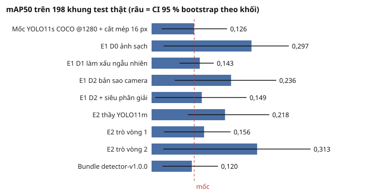
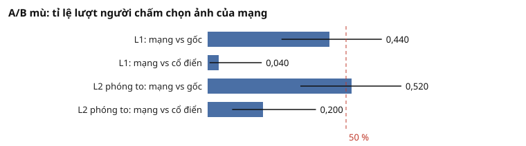
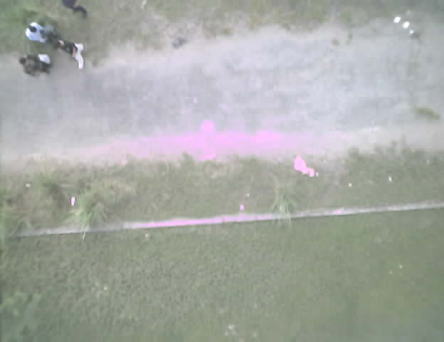
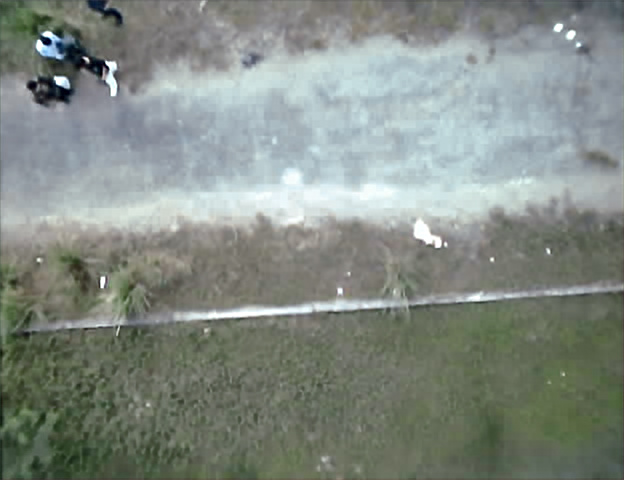
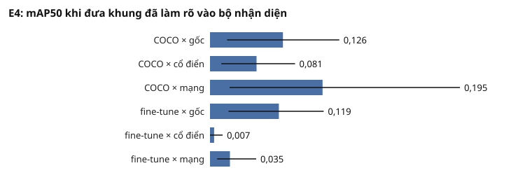
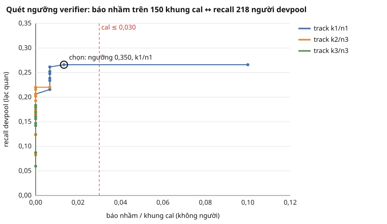

# HỌC VIỆN CÔNG NGHỆ BƯU CHÍNH VIỄN THÔNG (PTIT)
## KHOA TRÍ TUỆ NHÂN TẠO

# BÁO CÁO ĐỒ ÁN HỌC PHẦN XỬ LÝ ẢNH

**Đề tài:** Ảnh chất lượng thấp từ camera giá rẻ trên drone: làm rõ cho người xem và phát hiện người trên khung bay thật
**Loại đề tài:** Lựa chọn 2, dự án xử lý ảnh thực tế (có dùng mô hình học sâu mã nguồn mở đã huấn luyện sẵn rồi tinh chỉnh)
**Giảng viên hướng dẫn:** PGS.TS. Phạm Văn Cường
**Nhóm thực hiện:** 4 sinh viên
**Kiến thức học phần dùng tới:** chương 2 (biểu diễn ảnh, lấy mẫu), 3 (nâng cao chất lượng), 4 (hệ màu), 5 (biên), 6 (nén JPEG), 8 (nhận dạng), 9 (đạo đức AI)

Mọi bảng và hình trong báo cáo này được sinh bằng `python scripts/reproduce.py --write` từ kết quả đã lưu trong `results/`,
không gõ tay. `python scripts/reproduce.py --check` chấm lại toàn bộ dự đoán đã lưu trên CPU và so sha256 của từng bảng, hình
với `results/reproduce/manifest.json`.

---

## Tóm tắt

Drone của nhóm mang camera ESP32-S3 N16R8 + cảm biến OV3660, phát JPEG 640×480 chất lượng 12 qua Wi-Fi. Ảnh thu được ám
hồng ở vùng sáng, mờ như có sương, vỡ khối JPEG, tối dần ra bốn góc và có một dải đen 16 px ở mép trái. Đồ án làm hai việc
trên đúng khung bay thật ngày 02/11/2026: phát hiện người để cảnh báo, và làm rõ ảnh cho người xem trên trạm mặt đất.

Phần nhận diện: một YOLO11s huấn luyện trên ảnh làm xấu theo số đo của chính camera này (D2) đạt mAP50 0,236 trên 198 khung
test, gần gấp đôi mốc COCO có sẵn (0,126), và báo nhầm trên khung bay không người ít hơn hẳn làm xấu ngẫu nhiên (D1). Bản ship
`detector-v1.0.0` (trò tự huấn luyện vòng 1, xuất ONNX) chạy 23,6 ms/khung trung vị trong web điều khiển của drone, nhưng mAP50
trên test chỉ 0,120: chọn model theo tập dev-val đã không dự đoán đúng tập test lần này.

Phần làm rõ: bộ lọc cổ điển 9 ms/khung trên CPU thắng mạng NAFNet nhỏ ở 24/25 lượt chấm mù. Mạng xoá gần hết ám hồng nhưng
khử mù yếu, nhấp nháy giữa các khung, và chỉ thắng ảnh gốc 11/25 lượt. Mạng không được bật làm mặc định. Đưa ảnh đã làm rõ vào
bộ nhận diện đã tinh chỉnh làm mAP giảm rõ, nên hệ thống giữ quy tắc: nhận diện luôn chạy trên khung gốc.

Bản v2 (25–26/11/2026, mục 6) thêm một bộ xác minh từng hộp sau detector và đổi ảnh rõ trực tiếp sang bộ cổ điển xuất ONNX.
Trên cùng 198 khung test, báo nhầm trên khung bay không người giảm từ 0,881 xuống 0,289 hộp/khung và mAP50 tăng từ 0,120 lên
0,210, cả hai có CI của hiệu không chạm 0. Các đích đặt trước vẫn không đạt (mAP50 ≥ 0,30, recall ≥ 0,6), và đích báo nhầm
trên tập giữ kín chưa đo được vì không có phiên bay trống nào. Trong thử mù A/B v2, bộ cổ điển thắng ảnh gốc 25/25 lượt; siêu
phân giải offline ×2 thắng ảnh gốc 25/25 nhưng chỉ thắng bộ cổ điển 16/25, nên không được ship.

---

## 1. Bài toán và camera thật

### 1.1. Bối cảnh

Drone S500 bay bằng ArduPilot, trạm mặt đất là một web tự viết (FastAPI + React) chạy trên laptop. Camera là bo ESP32-S3
riêng, nối Mobile Hotspot của laptop, phát MJPEG qua HTTP. Lúc bay ngoài bãi, luồng ảnh đạt 2 đến 9 khung/s tuỳ khoảng cách và
tình trạng Wi-Fi. Laptop có GPU RTX 4060 Laptop 8 GB, nên mọi xử lý AI chạy trên laptop chứ không chạy trên drone.

Bản báo cáo trước của nhóm (giữ ở `archive/v2-nhom/`) viết cho camera ESP32-CAM OV2640 và chấm trên ảnh tự sinh. Camera thật
khác loại, và điểm số trên ảnh tự sinh không nói được gì về khung bay. Đồ án được làm lại từ đầu theo một luật: **điểm số chỉ
chấm trên khung bay thật**.

### 1.2. Đầu vào, đầu ra

- **Đầu vào:** một khung JPEG 640×480 BGR từ camera, chưa qua xử lý gì.
- **Đầu ra 1 (nhận diện):** các hộp `[x1, y1, x2, y2]` kèm độ tin cậy cho lớp người, trên toạ độ của chính khung đó.
- **Đầu ra 2 (ảnh rõ):** một khung 640×480 cùng cỡ, dễ nhìn hơn cho người vận hành.

Hai model được giao cho phần mềm drone (repo IOT-CV) qua một hợp đồng cố định (`docs/hop-dong-model.md`): tên và kiểu của
input/output, sha256 của file ONNX, bộ ảnh golden để kiểm sai số. Repo IOT-CV từ chối nạp model sai hợp đồng và báo lý do lên
web.

### 1.3. Ảnh camera này hỏng ở đâu (đo trên khung thật, `results/camera/profile_report.md`)

| Lỗi | Đo được | Liên hệ học phần |
|---|---|---|
| Ám hồng vùng sáng | kênh G sụt khi điểm ảnh gần bão hoà | chương 4, hệ màu |
| Mù như sương | dark channel trung vị cao, tương phản thấp | chương 3 |
| Vỡ khối JPEG | bảng lượng tử (DQT) của camera ở q12 đọc thẳng từ file, lấy mẫu màu 4:2:2 | chương 6 |
| Tối góc | tỉ lệ sáng góc/tâm < 1 | chương 2 |
| Dải đen mép trái | 16 px cột đầu gần như 0 | chương 2 |

Hồ sơ camera này (`configs/camera_profile.yaml`) là nền của mọi bước sau: bộ làm xấu D2, bộ lọc cổ điển, và cả việc nén khung
giả trong web cũng dùng đúng bảng DQT đo được.

---

## 2. Dữ liệu

- **Khung bay thật:** chuyến 02/11/2026, phiên 20261102-100941, một bãi bay, một buổi sáng. Từ 2 944 khung bay chọn khung cách
  nhau ít nhất 1 s, chia **theo khối thời gian** chứ không chia ngẫu nhiên, để khung test không có "anh em sinh đôi" trong
  khung huấn luyện.
- **Tập test:** 198 khung (39 khung có người, 149 hộp người), thêm 300 khung âm chụp trong nhà và 159 khung bay không người để
  đo báo nhầm. **Tập dev-val** 100 khung, chỉ dùng chọn model và ngưỡng. Vượt mức tối thiểu 50 ảnh đánh giá của đề.
- **Nhãn:** nhiều model + SAHI gán trước, soát từng khung bằng mắt, chủ dự án duyệt lần cuối trên Label Studio chạy tại máy.
- **Ảnh nguồn để huấn luyện:** VisDrone (ảnh drone có nhãn người) và NOMAD, đưa qua bộ làm xấu để giống camera. Ảnh VisDrone
  không bao giờ được commit; repo chỉ chứa khung của chính camera này.

---

## 3. Phương pháp

### 3.1. Hai bộ làm xấu

- **D1, ngẫu nhiên:** chuỗi suy giảm kiểu Real-ESRGAN (mờ, nhiễu, nén, đổi cỡ) với tham số rút ngẫu nhiên. Đây là cách làm
  phổ biến khi không biết camera đích.
- **D2, bản sao camera:** chuỗi tất định theo hồ sơ đo được: tối góc theo tiêu cự, mù theo mô hình khí quyển, ám hồng theo
  ngưỡng bão hoà, dải đen mép trái, rồi nén JPEG bằng đúng bảng DQT của camera. Tham số được hiệu chỉnh tự động (`xla.degrade.calibrate`)
  để thống kê ảnh làm xấu khớp khung dev thật.
- **D2 + Real-SR:** D2 cộng nhiễu lấy mẫu từ khung dev thật.

### 3.2. Đo độ giống thật

Ba thước đo, cùng chạy trên patch ảnh: tổng độ lệch của 18 thống kê mức thấp (màu, nhiễu, độ nét, khối JPEG, tối góc); C2ST,
tức độ chính xác của một bộ phân loại cố phân biệt patch thật với patch làm xấu (0,5 là không phân biệt được); và KID trên đặc
trưng DINOv2. Hàng "thật với thật" (khung dev so khung dev) cho biết mức sàn của từng thước đo.

### 3.3. Nhận diện (E1, E2)

- **Mốc:** YOLO11s COCO có sẵn, cỡ vào 1280 px, bỏ 16 px mép trái.
- **E1:** tinh chỉnh YOLO11s trên VisDrone qua từng bộ làm xấu D0 (ảnh sạch), D1, D2, D2 + siêu phân giải. Chọn model bằng
  mAP50 trên dev-val.
- **E2:** thầy YOLO11m gán nhãn giả cho khung bay chưa nhãn, trò YOLO11s học lại (hai vòng). Ship trò vòng 1 theo dev-val, xuất
  ONNX có resize trong graph, ngưỡng vận hành chọn bằng F1 tối đa trên dev-val.
- **Độ đo:** mAP50, mAP50-95, AR cho vật nhỏ, số hộp báo nhầm trên mỗi khung bay không người ở ngưỡng vận hành. CI 95 % bằng
  bootstrap theo khối thời gian (2 000 mẫu), so hai model bằng bootstrap ghép cặp.

### 3.4. Làm rõ ảnh

- **Cổ điển (`xla.enhance.classic`):** bù tối góc theo tiêu cự đo được, khử mù dark channel (patch 15 px), sửa ám hồng có mặt
  nạ mềm, cân bằng trắng bỏ qua vùng bão hoà. Phần nhóm làm ở bản trước được giữ ý tưởng mặt nạ hồng và cân bằng trắng có loại
  trừ; bỏ siêu phân giải và giải chập vì chúng làm nổi khối JPEG trên khung thật.
- **Mạng (`enhancer-v1.0.0`):** NAFNet bề rộng 16, học từ cặp (ảnh sạch, ảnh làm xấu D2), xuất ONNX.
- **Đánh giá:** tiêu chí đăng ký trước (giảm điểm hồng, giảm dark channel, không tăng nhấp nháy, thời gian, A/B), rồi chấm mù
  A/B: người chấm thấy hai ảnh cạnh nhau, trái phải xáo trộn, chọn ảnh dễ nhìn hơn. NR-IQA (MUSIQ, NIQE) chỉ để mô tả, không
  dùng để chọn gì.

### 3.5. E4: làm rõ trước khi nhận diện

Chạy hai bộ nhận diện (COCO có sẵn, bản đã tinh chỉnh) trên ba biến thể khung test (gốc, cổ điển, mạng), so mAP ghép cặp với
khung gốc. Luật đã chốt trước: chỉ chuyển nhận diện sang ảnh đã làm rõ khi CI của chênh lệch nằm trọn trên 0.

---

## 4. Kết quả

### 4.1. Độ giống thật

<!-- bang: results/reproduce/tables/t2_do_giong_that.md -->
| Bộ làm xấu | Lệch thống kê (tổng, nhỏ = giống) | C2ST (0,5 = không phân biệt được) | KID ×100 (nhỏ = giống) |
|---|---|---|---|
| D1 (Real-ESRGAN ngẫu nhiên) | 5,928 | 0,936 [0,909; 0,960] | 4,443 [4,291; 4,598] |
| D2 (bản sao camera, đã hiệu chỉnh) | 0,796 | 0,950 [0,930; 0,966] | 4,409 [4,236; 4,599] |
| D2 + Real-SR (nhiễu từ khung dev) | 0,663 | 0,923 [0,897; 0,945] | 3,994 [3,824; 4,169] |
| thật–thật: khung dev | 0,330 | 0,542 [0,494; 0,594] | 0,371 [0,290; 0,468] |
<!-- /bang -->

D2 giảm độ lệch thống kê từ 5,93 xuống 0,80, tức camera được sao chép đúng ở mức pixel. Nhưng C2ST vẫn khoảng 0,95 và KID gần
như không đổi: một bộ phân loại vẫn tách được patch thật khỏi patch làm xấu, nhiều khả năng vì nội dung ảnh VisDrone (đường phố đô thị,
góc nhìn cao) khác bãi bay của nhóm; giả thuyết này chưa được kiểm riêng. Khớp thống kê là cần, chưa đủ.

### 4.2. Nhận diện

<!-- bang: results/reproduce/tables/t1_nhan_dien.md -->
| Model | mAP50 [CI 95 %] | mAP50-95 | AR nhỏ | FP/khung bay không người | Ngưỡng (F1 dev-val) |
|---|---|---|---|---|---|
| Mốc: YOLO11s COCO @1280 + cắt mép 16 px | 0,126 [0,030; 0,224] | 0,063 | 0,531 | 0,597 | 0,068 |
| E1 D0 ảnh sạch | 0,297 [0,036; 0,408] | 0,100 | 0,519 | 1,195 | 0,053 |
| E1 D1 làm xấu ngẫu nhiên | 0,143 [0,083; 0,185] | 0,047 | 0,444 | 0,994 | 0,023 |
| E1 D2 bản sao camera | 0,236 [0,069; 0,370] | 0,079 | 0,426 | 0,302 | 0,089 |
| E1 D2 + siêu phân giải | 0,149 [0,011; 0,282] | 0,048 | 0,440 | 1,956 | 0,059 |
| E2 thầy YOLO11m | 0,218 [0,107; 0,349] | 0,060 | 0,425 | 0,390 | 0,054 |
| E2 trò vòng 1 | 0,156 [0,036; 0,235] | 0,052 | 0,419 | 0,868 | 0,075 |
| E2 trò vòng 2 | 0,313 [0,035; 0,472] | 0,157 | 0,446 | 0,522 | 0,018 |
| Bundle detector-v1.0.0 (ONNX, ship) | 0,120 [0,032; 0,197] | 0,042 | 0,240 | 0,881 | 0,077 |
<!-- /bang -->



Đọc bảng:

- D2 hơn D1 0,093 mAP50, CI [−0,073; +0,252] chạm 0, nên chưa đủ để nói D2 hơn D1 về mAP. Chỗ D2 hơn rõ là **báo nhầm**: 0,30
  hộp sai mỗi khung bay không người so với 0,99 của D1, chênh có CI nằm trọn dưới 0 (−0,692 [−1,238; −0,246]). Với một hệ thống
  cảnh báo, số báo nhầm quyết định người vận hành có tin cảnh báo hay không.
- D0 (ảnh sạch) có mAP cao nhất ở E1 nhưng CI rất rộng và báo nhầm cao. Dev-val chọn D2.
- E2: trò vòng 2 đạt mAP50 test cao nhất (0,313) nhưng dev-val của nó thấp hơn vòng 1 (0,296 so với 0,379), nên theo luật đã
  chốt nhóm ship vòng 1. Trên test, vòng 1 lại kém cả E1 D2. Dev-val 100 khung quá ít để xếp hạng các model
  sát nhau; đây là bài học chính của phần nhận diện.
- Bản ONNX ship (0,120) khớp bản `.pt` trong sai số xuất (−0,003 mAP50).

### 4.3. Làm rõ ảnh

<!-- bang: results/reproduce/tables/t3_tieu_chi_anh_ro.md -->
| Tiêu chí (mạng enhancer-v1.0.0, khung test) | Giá trị [CI 95 %] | Kết luận |
|---|---|---|
| % điểm hồng giảm ≥ 90 % | 0,999 [0,997; 1,000] | đạt |
| dark channel trung vị giảm ≥ 50 % | 0,368 [0,310; 0,459] | không đạt |
| nhấp nháy không tăng (≤ 1) | 1,806 [1,738; 1,920] | không đạt |
| thắng ≥ 70 % lượt A/B so với ảnh gốc | 0,440 [0,267; 0,629] | không đạt |
| thắng ≥ 55 % lượt A/B so với cổ điển | 0,040 [0,007; 0,195] | không đạt |
| ≤ 30 ms/khung (mạng, p50) | 20,696 | đạt |
| không làm giảm mAP nhánh B | -0,085 [-0,139; -0,011] | đạt |
<!-- /bang -->

<!-- bang: results/reproduce/tables/t4_ab.md -->
| Lượt chấm | So sánh | Mạng thắng | Tỉ lệ [Wilson 95 %] | Ngưỡng đạt |
|---|---|---|---|---|
| Lần 1, cả khung | mạng vs gốc | 11/25 | 0,440 [0,267; 0,629] | 0,700 |
| Lần 1, cả khung | mạng vs cổ điển | 1/25 | 0,040 [0,007; 0,195] | 0,550 |
| Lần 2, phóng to 2× | mạng vs gốc | 13/25 | 0,520 [0,335; 0,700] | 0,700 |
| Lần 2, phóng to 2× | mạng vs cổ điển | 5/25 | 0,200 [0,089; 0,391] | 0,550 |
<!-- /bang -->



| Khung gốc (20261102-100941_005_00934) | Sau mạng |
|---|---|
|  |  |

Mạng đạt 3/7 tiêu chí. Nó gần như xoá sạch điểm hồng (99,9 %) và nhanh (20,7 ms trung vị), nhưng màu ra nguội và nhạt, mù chỉ
giảm 37 % (cần 50 %), và độ nhấp nháy giữa hai khung liền nhau tăng 1,8 lần. Người chấm thích bản cổ điển hơn ở 24/25 lượt.
Lượt chấm lần 2 phóng to 2× cho mạng kết quả khá hơn (13/25 với ảnh gốc), và nếu chỉ đếm các lượt có người trong khung thì mạng
thắng ảnh gốc 17/21; đó là quan sát hậu kiểm, không phải tiêu chí đăng ký trước, nên không dùng để đổi kết luận.

Bộ cổ điển chạy 9,2 ms/khung trên CPU, giảm hồng 89 % và dark channel 52 %, nhưng nhấp nháy cũng tăng (2,18), nên chưa đạt
hết tiêu chí.

### 4.4. E4: có nên làm rõ trước khi nhận diện

<!-- bang: results/reproduce/tables/t5_e4.md -->
| Bộ nhận diện | Khung gốc | Sau cổ điển (chênh [CI]) | Sau mạng (chênh [CI]) |
|---|---|---|---|
| YOLO11s COCO (có sẵn) | 0,126 | 0,081 (-0,046 [-0,088; -0,006]) | 0,195 (+0,069 [-0,033; 0,231]) |
| detector-v1.0.0 (đã fine-tune) | 0,119 | 0,007 (-0,112 [-0,182; -0,028]) | 0,035 (-0,085 [-0,139; -0,011]) |
<!-- /bang -->



### 4.5. Chạy thật trong phần mềm drone (IOT-CV, phase 16)

Hai model chạy trong backend IOT-CV qua ONNX Runtime CUDA, trên chính JPEG ghi được của chuyến 02/11, phát lại đúng nhịp thời
gian thật của bản ghi.

<!-- bang: results/reproduce/tables/t6_iotcv_ms.md -->
| Chế độ | Detector p50 / p95 ms | Enhancer p50 / p95 ms | Tổng p50 / p95 ms | Khung/s xử lý |
|---|---|---|---|---|
| Nhịp thật, có người xem Ảnh rõ | 23,6 / 33,4 | 12,5 / 19,0 | 37,5 / 54,1 | 7,2 |
| Nhịp thật, chỉ detector | 35,8 / 67,0 | – | 36,6 / 67,9 | 7,2 |
| Hết tốc lực, hai model | 26,7 / 28,1 | 14,6 / 15,7 | 42,5 / 44,9 | 23,6 |

Điều kiện: GPU 72 °C, xung lúc nghỉ 1890/3105 MHz; bản ghi 20261102-100941, khung 284–914; bỏ khung 0,3 %.
<!-- /bang -->

Pipeline theo kịp camera (bỏ 0,3 % khung) và chạy hết tốc lực được 23,6 khung/s, gấp ba nhịp camera tốt nhất. Ngân sách đặt
trước là p95 tổng ≤ 50 ms và detector ≤ 30 ms. Ở nhịp thật hai p95 này vượt (54,1 và 33,4 ms), trong khi chạy hết tốc lực lại
đạt (44,9 và 28,1 ms). Lý do: giữa hai khung camera GPU rảnh khoảng 100 ms và tự hạ xung (1 890 so với 3 105 MHz tối đa), khung
kế tiếp chạy trên GPU chậm. Hàng "chỉ detector" còn chậm hơn vì GPU rảnh lâu hơn. Ngày 19/11 nhóm đặt "Prefer maximum performance" cho python.exe trong NVIDIA app rồi đo lại hai lần. Dưới tải liên tục GPU
giữ được 2,3–2,5 GHz (detector 24,7 ms trung vị), nhưng ở nhịp camera khoảng 7 khung/s xung vẫn tụt về 780 MHz giữa hai khung,
và tổng p95 ra 90–123 ms. Phần lớn chi phí là của chính detector: nó phóng khung lên 1280 px để thấy người ở xa, nên một khung
tốn khoảng 20–25 ms ngay cả khi GPU chạy hết xung. Nhóm **chấp nhận giới hạn này** và không nới ngân sách: trên laptop này,
ở nhịp camera thật, ngân sách p95 50 ms không đạt; test `tests/integration/test_iotcv_replay.py::test_ngan_sach_ms` để đỏ có
chủ đích. Bảng trên là lần đo tốt nhất (GPU 72 °C, chưa nóng).

---

## 5. Trả lời hai câu hỏi nghiên cứu

**Câu 1. Làm xấu theo số đo của chính camera (D2) có thắng làm xấu ngẫu nhiên (D1) trên khung thật không?**

Có, nhưng không ở chỗ dự đoán. Về độ giống thật ở mức pixel, D2 thắng rõ (lệch thống kê 0,80 so với 5,93). Về mAP50, D2 hơn
0,093 nhưng CI chạm 0, nên chưa kết luận được. Về báo nhầm trên khung bay không người, D2 thắng rõ với CI nằm trọn một phía. Cả
D1 lẫn D2 đều vẫn bị C2ST tách được khỏi ảnh thật, nên muốn tiến thêm phải đổi nội dung ảnh nguồn chứ không phải chỉnh tiếp bộ
làm xấu.

**Câu 2. Khôi phục ảnh trước khi nhận diện có giúp không?** Dự đoán ban đầu: giúp bộ có sẵn, không giúp bộ đã tinh chỉnh.

Chiều của kết quả khớp dự đoán, độ chắc thì chỉ một nửa. Với YOLO COCO có sẵn, ảnh qua mạng tăng mAP50 thêm 0,069 nhưng CI
[−0,033; +0,231] chạm 0. Với bộ đã tinh chỉnh, ảnh qua mạng làm mAP50 **giảm** 0,085, CI [−0,139; −0,011] nằm trọn dưới 0;
ảnh qua bộ cổ điển còn tệ hơn (−0,112). Bộ đã tinh chỉnh học trên ảnh xấu kiểu D2, nên ảnh "đẹp lại" là ảnh lạ với nó. Hệ
thống giữ quy tắc D5: nhận diện chạy trên khung gốc, ảnh rõ chỉ để người xem.

---

## 6. Bản v2: lọc ba tầng và ảnh rõ hai tầng (25–26/11/2026)

Bản v1 để lại hai vấn đề đo được: detector báo nhầm 0,881 hộp mỗi khung bay không người (túi rác, mảnh nhựa hồng, bóng người
bị nhận thành người, bảng mục 4.2), và mạng làm rõ thua cả ảnh gốc lẫn bộ cổ điển (mục 4.3). Bản v2 sửa đúng hai chỗ đó và
giữ nguyên cách chấm: tập test v1 198 khung chỉ dùng để chấm một lần, đích đặt trước khi chạy (plan
`plans/261125-ai-v2/plan.md`, báo cáo thiết kế `plans/reports/261125-brainstorm-cai-thien-ai-v2.md` §5). Tổng hợp số đo từng
phần: `results/v2/README.md`.

### 6.1. Thiết kế

- **Nhánh B, nhận diện ba tầng.** Tầng 1 là detector. Tầng 2 là bộ xác minh (verifier): một EfficientNet-B0 (torchvision)
  phân loại vùng cắt 96 px quanh từng hộp, phép cắt RoiAlign nằm ngay trong graph ONNX nên phần mềm drone không phải tự cắt.
  Tầng 3 lọc theo thời gian: ghép hộp giữa các khung bằng IoU, chỉ báo khi một track có k hộp trong n khung. Tầng 3 chỉ cài
  một lần, ở IOT-CV (`backend/vision/track_filter.py`); XLA hiệu chỉnh và chấm nó bằng cách gọi đúng mã đó.
- **Nhánh A, ảnh rõ hai tầng.** Trực tiếp: bộ cổ điển của mục 3.4 xuất thành ONNX `enhancer-v2.0.0` (sai khác với bản numpy
  MAE ≤ 0,018 trên 50 khung dev, `results/v2/classic/README.md` §2), thay NAFNet. Offline, sau chuyến bay: siêu phân giải ×2
  Real-ESRGAN x2plus tinh chỉnh trên cặp ảnh làm xấu D2 (`enhancer-offline-v1.0.0`, ảnh ra 1280×960).
- **Detector không đổi.** Trong các ứng viên trò YOLO11s, C3 (VisDrone sạch + nền `mine`) tốt nhất trên dự đoán ngoài fold
  (OOF, mAP50 0,321), nhưng chạy cùng đường ONNX thì không hơn `detector-v1.0.0` (−0,041 [−0,078; +0,018]), nên theo luật
  dừng ghi trước, không có `detector-v2.0.0` (`results/v2/detect/README.md` §1). Hệ chạy `detector-v1.0.1`: cùng file ONNX
  với v1.0.0, chỉ thêm cấu hình track vào meta. Trên test (chỉ chấm, không dùng để quyết) trò mới bản `.pt` lại hơn v1 +0,207 [+0,019; +0,308]; OOF trên devpool thiên về v1
  vì v1 đã học nhãn giả của phần lớn khung devpool. Luật dừng có thể đã cho một âm tính giả; nhóm ghi lại, không lấy test để
  đảo quyết định.

### 6.2. Dữ liệu ngoài và giấy phép

| Bộ | Giấy phép | Dùng cho | Ảnh sau lọc góc nhìn |
|---|---|---|---|
| HERIDAL (Zenodo 5662351) | CC BY 3.0 | tập trộn `d02x` (thầy, trò), mẫu dương và âm cho verifier | 1 684 (1 086 có người) |
| WiSARD Multi-Modal Sample | MIT | `d02x`, mẫu dương và âm cho verifier | 110 |
| TinyPerson | bộ dữ liệu không ghi giấy phép (mã MIT) | chỉ làm mẫu dương cho verifier (dưới 200 ảnh sau lọc) | 173 |
| VisDrone (như v1) | không ghi giấy phép, dùng nghiên cứu | `d02x` | — |

SARD bị bỏ vì IEEE DataPort đòi thuê bao trả phí. Ảnh ngoài không vào git; repo chỉ giữ mã đọc, sha256 file nén và manifest
(`results/v2/data/README.md` §1, §3). Trọng số ImageNet khởi tạo verifier (torchvision) cũng chỉ cho nghiên cứu. Vì vậy
model v2 là **kết quả nghiên cứu, chỉ dùng nghiên cứu**, không phải sản phẩm phân phối.

### 6.3. Chia dữ liệu theo phiên bay và luật chọn

- Một phiên là một chuyến bay (cửa sổ `python -m backend.flights --events` của IOT-CV). Bản ghi 20261102-100941 có 6 phiên.
  Khung bay không người chia làm ba phần theo phiên: `mine` để khai thác âm khó và huấn luyện, `cal` để hiệu chỉnh ngưỡng,
  `holdout` để chấm báo nhầm B2 và không được chạm vào lúc nào khác (`results/v2/neg-holdout/README.md` §2).
- Cả 6 phiên đều có khung test v1 (v1 chia khối 30 s xen kẽ trong cùng buổi), nên **holdout rỗng**. `cal` lấy trọn hai khối
  dev v1 (150 khung, 2 phiên); `mine` còn 85 khung sau khi bỏ 86 khung có người.
- Chọn model bằng k-fold theo phiên thay cho dev-val 100 khung của v1 (bài học mục 4.2): devpool 160 khung (70 khung có người,
  218 người), fold 0 = phiên #5, fold 1 = phiên #1 đến #4. Chỉ đủ khung có người cho 2 fold, nên phương sai giữa fold báo bằng
  mAP từng fold chứ không có CI riêng.
- Điểm vận hành (luật D7, chỉ trên `cal` + devpool): báo nhầm trên `cal` ≤ 0,03 hộp/khung để chừa biên cho đích 0,05 ở
  holdout, trong số đó lấy recall devpool lớn nhất, hoà thì lấy cấu hình đơn giản nhất. Lưới 720 điểm (ngưỡng verifier ×
  k × n × khoảng trống), chọn ngưỡng 0,35 và k = n = 1 (`results/v2/system/README.md` §3).

### 6.4. Kết quả nhánh B

<!-- bang: results/reproduce/tables/t7_v2_nhan_dien.md -->
| Tầng (CSV của IOT-CV) | mAP50 [CI 95 %] | Recall @ ngưỡng [CI] | Báo nhầm / khung bay trống (159) [CI] | / khung trong nhà (300) | Ngưỡng |
|---|---|---|---|---|---|
| 1 detector `detector-v1.0.1` (ONNX của v1.0.0) | 0,119 [0,032; 0,197] | 0,396 [0,271; 0,500] | 0,874 [0,333; 1,486] | 0,003 | 0,077 |
| 2 + `verifier-v1.0.0` @0,350 | 0,210 [0,122; 0,312] | 0,396 [0,271; 0,500] | 0,289 [0,036; 0,631] | 0,003 | 0,350 |
| 3 + lọc track k1/n1 (cả hệ) | 0,210 [0,122; 0,312] | 0,396 [0,271; 0,500] | 0,289 [0,036; 0,631] | 0,003 | 0,350 |

Test v1: 198 khung (39 có người, 149 người). CI 95 % bootstrap theo khối 30 s.

| Mốc → cả hệ (tầng 3): hiệu [CI 95 %] | mAP50 | Recall @ ngưỡng | Báo nhầm / khung bay trống |
|---|---|---|---|
| `detector-v1.0.0` (v1, chỉ detector) | 0,120 → 0,210: +0,090 [+0,026; +0,189] | 0,396 → 0,396: +0,000 [+0,000; +0,000] | 0,881 → 0,289: -0,591 [-1,033; -0,273] |
| mốc COCO + cắt mép 16 px | 0,126 → 0,210: +0,083 [-0,071; +0,219] | 0,329 → 0,396: +0,067 [-0,219; +0,244] | 0,597 → 0,289: -0,308 [-0,690; +0,091] |

| Chỉ số §5 (nhánh B) | v2 | Đích | Kết luận |
|---|---|---|---|
| B1: mAP50 cả hệ | 0,210 [0,122; 0,312] | ≥ 0,300 | **không đạt** |
| B1 tối thiểu: mAP50 và hiệu với mốc edge16 | 0,210; +0,083 [-0,071; +0,219] | ≥ 0,227 và cận dưới hiệu > 0 | **không đạt** |
| B2: báo nhầm / khung, holdout giữ kín (tầng 3) | không đủ chứng minh (0 khung) | ≤ 0,050 | **không đủ chứng minh** |
| B2 trên holdout yếu (cùng buổi, agent duyệt) | không đủ chứng minh (0 khung) | ≤ 0,050 | **không đủ chứng minh** |
| Recall @ ngưỡng vận hành | 0,396 [0,271; 0,500] | ≥ 0,600 | **không đạt** |
<!-- /bang -->



Đọc bảng:

- **Đích không đạt.** B1 (mAP50 ≥ 0,30), B1 tối thiểu và recall ≥ 0,6 đều không đạt. B2 không đo được vì holdout có 0 khung;
  holdout yếu lấy khung cùng buổi cách mọi khối dev/test ≥ 30 s cũng ra 0 khung. Báo nhầm 0,289/khung ở bảng là trên khung
  bay trống của **test**, để so với v1, không phải B2.
- **Cái v2 cải thiện được, CI không chạm 0.** So với v1 trên cùng 198 khung: mAP50 0,120 → 0,210 (+0,090 [+0,026; +0,189]),
  báo nhầm trên khung bay trống 0,881 → 0,289 (−0,591 [−1,033; −0,273], giảm khoảng hai phần ba), recall không đổi (không mất
  người nào ở ngưỡng vận hành). Cả phần cải thiện là của verifier. Tầng 3 ở k = 1 trùng tầng 2 từng hộp. Detector vẫn là v1 nên recall
  đứng ở 0,396.
- **Hình.** Mỗi đường là một cấu hình track khi quét ngưỡng verifier. Lọc track k ≥ 2 bỏ được nốt 2 hộp sai trên `cal`
  nhưng mất ít nhất 10 người trên devpool, nên D7 không chọn. Recall devpool trên hình lạc quan: verifier là OOF nhưng
  detector v1 thì không (nó đã học nhãn giả của khung dev). Recall trên test ở bảng là số không thiên lệch.
- So với mốc COCO + cắt mép, cả hệ hơn mAP50 +0,083 nhưng CI chạm 0.

### 6.5. Kết quả nhánh A: thử mù A/B v2

Chủ dự án chấm 80 cặp trên khung dev có người (không dùng khung test), 25 cặp mỗi so sánh + 5 cặp lặp, trái phải xáo trộn,
tên ảnh là mã hex. Tiêu chí chốt trước khi chấm: một so sánh đạt khi cận dưới Wilson 95 % > 0,5 (với 25 cặp là từ 18/25);
offline chỉ được ship khi qua hàng rào báo nhầm **và** thắng cả gốc lẫn classic ở lượt cả khung (lượt phóng to chỉ báo cáo,
luật sửa trước khi chấm ở commit b545b64, `results/ab-v2/README.md` §3).

<!-- bang: results/reproduce/tables/t8_v2_ab.md -->
| Lượt | So sánh | Bên thứ nhất thắng | Tỉ lệ [Wilson 95 %] | Cận dưới > 0,5 |
|---|---|---|---|---|
| cả khung | offline ×2 vs gốc | 25/25 | 1,000 [0,867; 1,000] | đạt |
| cả khung | offline ×2 vs classic | 16/25 | 0,640 [0,445; 0,798] | **không đạt** |
| cả khung | classic vs gốc | 25/25 | 1,000 [0,867; 1,000] | đạt |
| phóng to 2× | cả ba so sánh | chưa chấm | – | không quyết định (luật chốt trước khi chấm) |

Cặp lặp đổi bên: 5/5 chọn như lần đầu.

| Hàng rào báo nhầm (detector trên khung cal không người) | Gốc | Offline ×2 | Hiệu [CI 95 %] | Kết luận |
|---|---|---|---|---|
| 150 khung, 16 khối, 2 phiên | 15 hộp = 0,100 | 10 hộp = 0,067 | -0,033 [-0,123; +0,039] | qua |

Ship `enhancer-offline-v1.0.0`: **không** (lượt cả khung không thắng cả gốc lẫn classic).
<!-- /bang -->

- **Classic thắng gốc 25/25.** Điều này củng cố quyết định của chủ dự án bật "Ảnh rõ" classic làm mặc định trong IOT-CV
  (quyết định có từ trước A/B, A/B không đổi nó).
- **Offline thắng gốc 25/25 nhưng chỉ thắng classic 16/25**, cận dưới 0,445 < 0,5: không ship. Nó còn đắt hơn
  (0,404 s/khung, 0,758 giờ GPU cho chuyến 20 phút, bảng mục 6.6), nhấp nháy tăng 1,35 lần (trần 1,15) và màu ngả lạnh
  (`results/v2/sr/README.md` §3). IOT-CV không cài nó: API offline trả 503, web tắt nút dựng.
- **So với v1.** A/B ngày 19/11 so mạng NAFNet `enhancer-v1.0.0` với ảnh gốc: 11/25 ở lượt cả khung, 13/25 ở lượt phóng to 2×
  (bảng mục 4.3). Ở v2, ảnh rõ trực tiếp (classic) thắng gốc 25/25. Hai lần không so ghép cặp được: khác model (NAFNet so với
  classic), khác tập khung (test ở v1, dev ở v2) và khác tiêu chí (v1 đòi ≥ 70 % lượt thắng, v2 đòi cận dưới Wilson > 0,5).
  **Nhận xét của chủ dự án** (cảm nhận khi chấm ngày 26/11, không phải số đo): kết quả làm rõ lần này rõ ràng tốt hơn lần thử
  ngày 19/11.
- Giới hạn của phép thử: 25 cặp mỗi so sánh nên CI rộng; ảnh SR ×2 không còn lưới khối JPEG nên người chấm có thể nhận ra
  biến thể; một người chấm.

### 6.6. Chạy trong phần mềm drone

IOT-CV nạp ba bundle ship (`detector-v1.0.1`, `verifier-v1.0.0`, `enhancer-v2.0.0`), kiểm golden trên CUDA và CPU đều đạt
(`results/v2/iotcv/README.md` §1). Bench phát lại 600 khung của chuyến 02/11 đúng nhịp thật, bốn lượt xen kẽ v1 và v2 trong
một tiến trình:

<!-- bang: results/reproduce/tables/t9_v2_ms.md -->
| Luồng, nhịp thật | Bước | v1 p50 / p95 ms | v2 p50 / p95 ms | Hiệu p95 | Trần | Kết luận |
|---|---|---|---|---|---|---|
| có người xem Ảnh rõ | detector | 53,2 / 63,3 | 57,4 / 63,4 | +0,15 |  |  |
|  | verifier | – / – | 0,0 / 8,9 | – |  |  |
|  | enhancer | 29,7 / 34,4 | 15,4 / 19,3 | -15,12 |  |  |
|  | tổng | 84,5 / 99,1 | 76,3 / 89,5 | -9,65 | +5,0 | đạt |
| chỉ nhận diện | detector | 60,0 / 63,3 | 59,6 / 63,3 | -0,01 |  |  |
|  | verifier | – / – | 0,0 / 9,4 | – |  |  |
|  | tổng | 60,8 / 64,0 | 61,1 / 72,4 | +8,39 | +5,0 | **không đạt** |

v1 = `detector-v1.0.0` + `enhancer-v1.0.0`; v2 = `detector-v1.0.1` + `verifier-v1.0.0` + `enhancer-v2.0.0`. Bản ghi 20261102-100941, khung 284–884, 4 lượt xen kẽ v1-v2-v2-v1. Máy: xung GPU trung vị mỗi lượt 780–802 MHz (tối đa 3105), 70–72 °C; bỏ khung có Ảnh rõ: v1 7,8 · 8,2 %, v2 4,2 · 4,7 %.

| Ảnh rõ offline ×2 (`enhancer-offline-v1.0.0`, không ship) | s / khung TB (p95) | Khung / s của bản ghi | Giờ GPU cho chuyến 20 phút |
|---|---|---|---|
| ORT CUDA fp16, 20 khung dev | 0,404 (0,526) | 5,6 | 0,758 |
<!-- /bang -->

- Trần đặt trước: p95 tổng của v2 không tăng quá 5 ms so với v1 đo cùng lúc. Luồng có "Ảnh rõ" (mặc định từ v2) **đạt**:
  classic ONNX nhẹ hơn NAFNet khoảng 15 ms p95, bù hết phần verifier thêm vào. Luồng chỉ nhận diện (người xem tắt "Ảnh rõ")
  **không đạt**: verifier thêm khoảng 9 ms p95 ở những khung có hộp qua ngưỡng detector.
- GPU hạ xung về khoảng 780 MHz suốt buổi đo, nên số tuyệt đối cao hơn nhiều so với mục 4.5; trần +5 ms đo chênh lệch giữa hai
  cấu hình cùng điều kiện, không đo số tuyệt đối.
- Dòng offline là ước giờ GPU cho một chuyến, tính từ s/khung đo trên 20 khung dev và tốc độ khung của bản ghi; bundle này
  không ship nên chưa chạy một chuyến offline thật nào trong IOT-CV.

### 6.7. Giới hạn của v2

- **Một buổi bay, 39 khung test có người.** Mọi khung chấm có người đều từ bản ghi 20261102-100941. Vật dễ nhầm (túi rác,
  mảnh nhựa hồng, bóng người) lặp lại giữa các phiên cùng buổi, nên khung `cal`, devpool và test không độc lập như khung từ
  hai buổi khác nhau.
- **B2 chưa chứng minh được.** Cần bay một buổi trên bãi trống không người rồi chạy lại đường chấm holdout đã có sẵn.
- **Recall bị chặn bởi detector v1.** Verifier không làm mất người nào ở điểm vận hành; muốn recall ≥ 0,6 phải đổi detector.
- **Ảnh offline do AI dựng lại.** Siêu phân giải có thể bịa chi tiết. Bản không ship, nhưng nếu dùng thì phải luôn ghi nhãn
  "ảnh do AI dựng lại" và luôn có nút xem gốc.
- **Verifier tốn thời gian.** Khi khung có hộp, verifier chạy 4–6 ms ở xung GPU 1 890 MHz và p95 khoảng 9 ms ở 780 MHz,
  vượt đích < 3 ms đặt ở thiết kế (`results/v2/verifier/README.md` §5, `results/v2/system/README.md` §6).

---

## 7. Giới hạn

- **Một bãi, một buổi:** mọi số đo đến từ chuyến 02/11/2026. Ánh sáng, độ cao, nền cỏ khác thì hồ sơ camera và điểm số có thể
  đổi.
- **Nhãn máy gán rồi người duyệt:** sai sót kiểu bỏ sót người rất nhỏ ở trên cao vẫn có thể còn.
- **Tập nhỏ:** 39 khung test có người, CI của mAP rộng (thường ±0,1). Dev-val 100 khung không chọn đúng model ở E2.
- **Hồ sơ camera khớp 02/11:** bảng DQT chỉ đo ở chất lượng q12. Web IOT-CV hạ chất lượng xuống q40 khi Wi-Fi yếu, và bảng DQT ở
  các mức đó chưa đo; khung giả ở q ≠ 12 trong IOT-CV vẫn nén theo ước lượng.
- **Ngân sách ms ở nhịp thật không đạt** trên laptop này (mục 4.5): detector 1280 px tốn 20–25 ms mỗi khung, GPU hạ xung
  giữa hai khung camera kể cả khi đặt chế độ hiệu năng tối đa. Pipeline vẫn theo kịp camera (bỏ 0,3–16 % khung tuỳ lần đo).
- **NR-IQA** (MUSIQ, NIQE) dùng giấy phép phi thương mại và chỉ để mô tả.
- Giới hạn riêng của bản v2: mục 6.7.

## 8. Việc tiếp

1. Sửa tận gốc ở lần bay tới: hạ ám hồng bằng phơi sáng và cân bằng trắng của chính cảm biến, che dải đen mép trái bằng cửa sổ
   cảm biến, đo DQT ở q40.
2. Thu thêm khung bay có người ở nhiều độ cao, nhiều buổi, để dev-val đủ lớn chọn model.
3. Mạng làm rõ: thêm ràng buộc màu và ràng buộc thời gian (khung liền nhau) khi huấn luyện, chấm lại bằng trang A/B phóng to.
4. Nếu cần đạt ngân sách ms: thử detector imgsz 960 hoặc FP16 và chấm lại mAP trên 198 khung test, hoặc khoá xung GPU
   (`nvidia-smi -lgc`) trong lúc bay.
5. Bản v2: bay một buổi trên bãi trống không người để có tập giữ kín đo B2; thu khung có người từ buổi khác để chấm lại luật
   dừng của detector (OOF hiện thiên về v1); nếu cần trần ms của luồng chỉ nhận diện, thử verifier `mnv3s_64` nhẹ hơn.

---

## 9. Tái lập

```powershell
. .\scripts\env.ps1                                   # cache, venv ở ổ D
uv sync --locked
uv run --no-sync python scripts/reproduce.py --check  # CPU: chấm lại 18 tệp dự đoán (15 của v1, 3 tầng cả hệ v2), so sha256 13 bảng/hình
uv run --no-sync python scripts/reproduce.py --full --dry-run  # danh sách bước GPU của v1, khoảng 6,6 giờ GPU
```

`--full` chỉ liệt kê các bước GPU của v1. Các bước của v2 (thầy, trò k-fold, verifier, hiệu chỉnh cả hệ, classic ONNX, SR ×2)
ghi lệnh trong README của từng thư mục `results/v2/*/`.

`meta.json` và `golden/` của mọi bundle nằm ở `models/release/`; file `.onnx` ở GitHub Release `models-v1.0.0` (v1) và
`models-v2.0.0` (v2: `detector-v1.0.1`, `verifier-v1.0.0`, `enhancer-v2.0.0`). `python -m xla.contract validate <thư mục>`
in `[]` khi bundle đúng hợp đồng (v1.1, `docs/hop-dong-model.md`).

## 10. Phân công nhóm

Bảng phân công của bản trước (bốn thành viên, mỗi người 25 %, mỗi người một giai đoạn của pipeline cổ điển) giữ nguyên ở
`archive/v2-nhom/BAO_CAO_DO_AN.md` mục 6. Phần làm lại theo camera thật (đo hồ sơ camera, bộ làm xấu D2, nhãn tập test, E1, E2, E4, A/B, tích hợp vào
phần mềm drone) do nhóm làm cùng trợ lý AI, chủ dự án duyệt nhãn và chấm A/B.

## 11. Khai báo sử dụng AI

- **Model mã nguồn mở dùng trong hệ thống:** YOLO11s/YOLO11m (Ultralytics, tinh chỉnh lại), NAFNet (huấn luyện lại từ đầu),
  DINOv2 (chỉ để đo KID). Bản v2: EfficientNet-B0 (torchvision, khởi từ trọng số ImageNet, tinh chỉnh làm verifier),
  Real-ESRGAN x2plus (tinh chỉnh, không ship); dữ liệu ngoài HERIDAL, TinyPerson, WiSARD chỉ dùng nghiên cứu (mục 6.2).
- **Trợ lý AI (Claude Code):** viết phần lớn mã, chạy thí nghiệm, sinh bảng và viết nháp báo cáo này. Mọi số trong báo cáo đến
  từ file kết quả do mã chạy ra và được `scripts/reproduce.py --check` kiểm lại; nhóm đọc, duyệt và chịu trách nhiệm về kết
  luận.
- **Đạo đức (chương 9):** chỉ khung của camera nhóm được công bố; ảnh VisDrone dùng nghiên cứu, không đăng lại; ảnh mẫu trong báo cáo
  và slide là khung bay của nhóm.

## Tài liệu tham khảo

1. Phạm Văn Cường, *Bài giảng Xử lý ảnh, chương 1 đến 9*, Khoa Trí tuệ Nhân tạo, PTIT, 2026.
2. R. C. Gonzalez, R. E. Woods, *Digital Image Processing*, 4th ed., Pearson, 2018.
3. K. He, J. Sun, X. Tang, "Single Image Haze Removal Using Dark Channel Prior", IEEE TPAMI 33(12), 2011.
4. X. Wang và cộng sự, "Real-ESRGAN: Training Real-World Blind Super-Resolution with Pure Synthetic Data", ICCVW 2021.
5. L. Chen, X. Chu, X. Zhang, J. Sun, "Simple Baselines for Image Restoration" (NAFNet), ECCV 2022.
6. P. Zhu và cộng sự, "Detection and Tracking Meet Drones Challenge" (VisDrone), IEEE TPAMI 44(11), 2022.
7. M. Bińkowski và cộng sự, "Demystifying MMD GANs" (KID), ICLR 2018.
8. D. Lopez-Paz, M. Oquab, "Revisiting Classifier Two-Sample Tests", ICLR 2017.
9. M. Oquab và cộng sự, "DINOv2: Learning Robust Visual Features without Supervision", TMLR 2024.
10. A. RoyChowdhury và cộng sự, "Automatic Adaptation of Object Detectors to New Domains Using Self-Training", CVPR 2019.
11. ISO/IEC 10918-1 (JPEG), phụ lục K: bảng lượng tử mẫu.
12. D. Božić-Štulić, Ž. Marušić, S. Gotovac, "Deep Learning Approach in Aerial Imagery for Supporting Land Search and Rescue
    Missions" (HERIDAL), IJCV 127, 2019.
13. X. Yu và cộng sự, "Scale Match for Tiny Person Detection" (TinyPerson), WACV 2020.
14. D. Broyles và cộng sự, "WiSARD: A Labeled Visual and Thermal Image Dataset for Wilderness Search and Rescue", IROS 2022.
15. M. Tan, Q. V. Le, "EfficientNet: Rethinking Model Scaling for Convolutional Neural Networks", ICML 2019.
