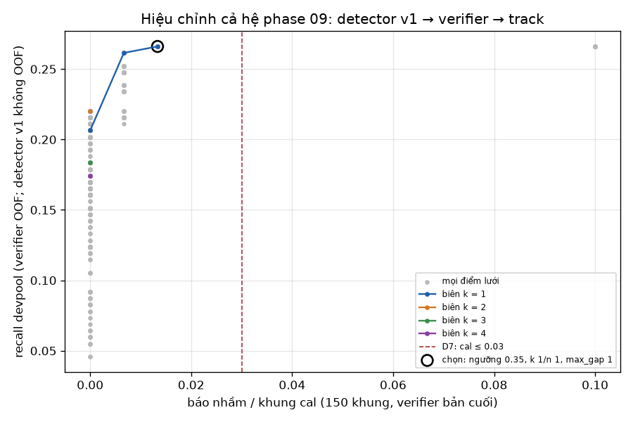

# Cả hệ detector → verifier → lọc track (AI v2 phase 09, serial)

Ngày 25/11/2026. Nhánh `feat/ai-v2`. Mã `xla/eval/system.py`, test `tests/integration/test_system_v2.py`. Hợp đồng
`docs/hop-dong-model.md` §9, §10, §14 (SSOT). IOT-CV chỉ chạy, không sửa: worktree `D:\IOTCV-wt\iotcv`, nhánh
`lane/iotcv` @ `0615648` (`scripts/vision/replay_pred.py`, `backend/vision/track_filter.py` của phase 08).

```bash
$PY -m xla.eval.system calibrate --iotcv D:/IOTCV-wt/iotcv --workers 4 --json   # bước 2 -> calibrate.json + calibrate_curve.png
$PY -m xla.eval.system apply --json                                             # bước 3 -> detector-v1.0.1, verifier conf_threshold
$PY -m xla.eval.system score --iotcv D:/IOTCV-wt/iotcv --json                   # bước 4, MỘT lần -> score.json + preds/
$PY -m xla.eval.system bench --iotcv D:/IOTCV-wt/iotcv --json                   # bước 5 -> bench.json
$PY -m pytest tests/integration/test_system_v2.py
```

Mọi lượt sang IOT-CV chạy `uv run --no-sync` trong venv **của IOT-CV** (env con bỏ `UV_PROJECT_ENVIRONMENT`/`VIRTUAL_ENV`
của XLA; worktree lane không có `.venv` riêng nên trỏ vào venv của clone chính `d:\Coding\IOT-CV\.venv`, chỉ khi
`pyproject.toml` + `uv.lock` hai bên trùng từng byte, `system.iotcv_venv`). Mỗi việc GPU (calibrate, score, bench) giữ
khoá D6 `xla.gpu_lock` **một lần** cho cả việc và nhả ngay khi xong (`system.held_gpu`): hai lane classic/sr cùng dùng
GPU, nhả giữa từng lượt thì lane khác chen vào giữ 20–30 phút mỗi lần (đã gặp: một lượt parity chờ 25 phút).

## 1. Kết luận

**Điểm vận hành (D7, chỉ trên cal + devpool):** ngưỡng verifier **0,35**, track **k = 1, n = 1, max_gap = 1** (iou 0,3).
Báo nhầm cal 2/150 = **0,0133** hộp/khung (≤ 0,03); recall devpool **0,266** (58/218; verifier OOF, detector v1 không OOF).
Lọc track k ≥ 2 không được chọn: bỏ nốt 2 hộp cal nhưng mất ≥ 10 người (mục 3).

Bảng chỉ số §5 brainstorm, nhánh B (chấm **một lần**, test v1 198 khung + 300 khung `neg`; hiện tại = v1 / bundle
`detector-v1.0.0` chỉ detector):

| Chỉ số | Hiện tại (v1) | v2 (cả hệ) | Đích | Đạt? |
|---|---|---|---|---|
| B1: test mAP50 (đường ONNX, cả hệ detector → verifier) | 0,120 [0,032; 0,197] | **0,210 [0,122; 0,312]** | ≥ 0,30 | **không đạt** |
| B1 tối thiểu: mAP50 ≥ 0,227 và cận dưới CI hiệu vs `edge16` > 0 | 0,120; vs edge16 −0,007 [−0,138; +0,066] | 0,210; vs edge16 **+0,083 [−0,071; +0,219]** | cả hai vế | **không đạt** (cả hai vế) |
| B2: báo nhầm/khung `neg_flight` phần giữ kín sau tầng 2 + 3 | — (holdout 0 khung) | **không đủ chứng minh (0 khung)** | ≤ 0,05 | **không đủ chứng minh** (Kill (a)) |
| Recall ở ngưỡng vận hành (test) | 0,396 [0,271; 0,500] | **0,396 [0,271; 0,500]** | ≥ 0,6 | **không đạt** |
| ms trực tiếp (p95 nhịp thật, cùng lúc đo) | 102,8 ms (GPU hạ xung 780 MHz) | **173,3 ms** | ≤ v1 + 5 ms | **không đạt** (+70,5 ms) |

- Cái v2 thật sự cải thiện, có CI không chạm 0 (ghép cặp với v1 trên test): mAP50 **+0,090 [+0,026; +0,189]**, báo nhầm
  trên khung bay trống của test 0,881 → **0,289** (−0,591 [−1,033; −0,273]), không mất người nào ở ngưỡng. Đó là công của
  verifier; track ở k = 1 không thêm gì; detector vẫn là v1 nên recall đứng yên (mục 4).
- Hai bundle cho IOT-CV: `models/release/detector-v1.0.1/` (= v1.0.0 + `recommended_track`) và
  `models/release/verifier-v1.0.0/` (`conf_threshold` 0,35). `xla.contract validate` cả hai → `[]`.
- Ba việc mở cho chủ dự án: (1) bay một buổi bãi trống để có holdout (B2); (2) chọn có giữ `k = 1` (sự kiện từ một hộp
  đã qua verifier, cooldown theo track) hay đặt `DETECTION_TRACK_K/N` (mục 3); (3) verifier lần đầu mỗi N hộp tốn ~60 ms
  ở IOT-CV (mục 6).

## 2. Bundle của cả hệ (quyết định phiên chính / chủ dự án 25/11)

- **Không có `detector-v2.0.0`** (phase 06, Kill (b)): detector của hệ là `detector-v1.0.0`. Bundle đã phát hành
  `detector-v1.0.0/` **không sửa**. `recommended_track` ghi vào bundle mới **`models/release/detector-v1.0.1/`**: cùng
  `detector.onnx` (sha256 `23b1da69…aef`, không đổi) + cùng `golden/` của v1.0.0; `meta.json` = meta v1.0.0 thêm
  `recommended_track`, `contract_version` "1.1", `version` "1.0.1" (test `test_detector_v101_cung_onnx_v100` kiểm từng
  khoá còn lại trùng v1.0.0). `xla.contract validate models/release/detector-v1.0.1` → `[]`. Plan ghi Owns
  `detector-v2.0.0/meta.json`; đổi thành `detector-v1.0.1/**` theo quyết định này.
- `verifier-v1.0.0/meta.json`: chỉ `conf_threshold` 0,375 → **0,35** (bước lưới 0,05 của phase 09). `xla.contract validate`
  → `[]`. `metrics` của meta vẫn là số phase 07 đo ở 0,375 (Owns chỉ cho đổi `conf_threshold`); số ở 0,35 nằm ở mục 3.
- `.onnx` không vào git (`.gitignore`); IOT-CV nhận bundle bằng `scripts/vision/lay_model.py --from <bundle>` vào
  `D:\IOTCV-wt\iotcv\models\vision\` (`/models/vision/` có trong `.gitignore` của IOT-CV, không commit gì ở IOT-CV).

## 3. Hiệu chỉnh trên `cal` + devpool (bước 2, D7) — `calibrate.json`, `calibrate_curve.png`

**Ngữ cảnh phát lại.** Một bản ghi (`20261102-100941`, 11 908 dòng `frames.csv`). `--blank` ở **mọi** lượt = 198 khung
test v1 + 0 khung holdout + 85 khung mine (`cal_mode: block`) = 283 khung; `--frames` = 150 khung cal ∪ 160 khung devpool
(82 + 78 theo fold). Phát lại 11 625 khung, 0 khung đọc không được, **502 lần xoá track** (khung test/mine là khung lấy
mẫu rải rác, mỗi khung blank là một đoạn riêng: vào và ra đều xoá).

**Cái gì là OOF.** Verifier: khung devpool fold k chấm bằng verifier **fold k** (`effb0_96_f<k>` của phase 07, huấn luyện
không có fold k; xuất ONNX §9 bằng đúng `xla.verify.export_onnx`, parity ORT CPU ↔ PyTorch ≤ 2e-6; xuất lại bản cuối bằng
cùng đường cho đúng từng số của `verifier.onnx` đã ship). Cal chấm bằng verifier bản cuối (cái ship; cal chưa từng vào
huấn luyện). **Detector KHÔNG OOF**: `detector-v1.0.0` (E2 r1) học nhãn giả của khung dev v1 (gồm phần lớn devpool) và
chọn checkpoint + ngưỡng trên dev-val v1 (86 khung nằm trong devpool) — `results/v2/detect/README.md` §4; C2 không chạy
nên không có ONNX detector từng fold. Recall devpool dưới đây vì vậy **lạc quan**; khung cal cũng là khung dev v1 mà
detector v1 đã thấy lúc huấn luyện (`results/v2/neg-holdout/README.md`, Lệch 2).

**Cách chạy lưới.** Lưới đủ như phase: ngưỡng verifier 0,00–0,95 bước 0,05 × k ∈ {1..4}, n ∈ {k..6} × `max_gap` ∈ {1, 2},
iou 0,3 (= `FALLBACK_IOU` của `track_filter.py`; plan không đưa iou vào lưới) = **720 điểm**, không thu nhỏ. Mỗi điểm là
một lượt phát lại GPU (~9 phút) thì 720 × 3 lượt là hơn 300 giờ, nên: mỗi verifier (bản cuối, fold 0, fold 1) chạy
detector + verifier **thật** một lượt (`replay_pred.run --stage verifier`, ghi lại đầu ra ONNX từng khung theo thứ tự);
mỗi điểm lưới chạy lại **đúng** `replay_pred.run` + `_Replay.rows_for` + `TrackFilter` của IOT-CV, chỉ thay phép suy luận
ONNX + giải mã JPEG bằng đầu ra đã ghi (`system._iotcv_grid`). Ba điểm phát lại thật `replay_pred.py --stage track` và so
CSV **từng byte** với CSV mô phỏng: điểm chọn (bản cuối, 107 hộp), `t0.25 k2 n2 g2` (fold 0, 47 hộp), `t0.50 k2 n2 g2`
(fold 1, 29 hộp) — **trùng cả ba**. GPU: ba lượt ghi 619 + 546 + 578 s, ba lượt parity 558 + 550 + 474 s (≈ 55 phút); lưới
138 s CPU (4 tiến trình), chấm 19 s.

**Luật chọn (D7).** Báo nhầm/khung cal ≤ 0,03 (cal không có người: agent soát từng khung ở phase 03, nên mọi hộp trên cal
là báo nhầm); trong đó recall devpool lớn nhất (recall = người có hộp IoU ≥ 0,5, `xla.eval.detection.prf_at`, 218 người);
**vùng hoà** = kém điểm tốt nhất ≤ 1 người (1/218 = 0,0046, dưới độ phân giải của tập); trong vùng hoà lấy điểm **đơn
giản nhất** = (k, n, max_gap) nhỏ nhất, rồi recall cao, báo nhầm cal thấp, ngưỡng cao. 708/720 điểm qua cal ≤ 0,03; vùng
hoà 108 điểm.

| Điểm | ngưỡng verifier | k / n / max_gap | báo nhầm cal (hộp / khung) | recall devpool (người) | hộp sai trên devpool |
|---|---|---|---|---|---|
| chỉ detector (tham chiếu) | — (0,00) | 1 / 1 / 1 | 15 / 0,100 | 58 / 218 = 0,266 | 79 |
| **chọn (D7)** | **0,35** | **1 / 1 / 1** | **2 / 0,0133** | **58 / 218 = 0,266** | 54 |
| ngưỡng phase 07 (~0,375) | 0,40 | 1 / 1 / 1 | 1 / 0,0067 | 57 / 218 = 0,261 | 53 |
| tốt nhất có lọc track (k ≥ 2) | 0,05 | 2 / 3 / 1 | 0 / 0 | 48 / 218 = 0,220 | 33 |

- Verifier ở 0,35 bỏ 13/15 hộp sai trên cal và 25/79 hộp sai trên devpool mà **không mất người nào** (OOF). Mọi ngưỡng
  0,05–0,35 cho cùng 58 người và cùng 2 hộp cal; luật chọn ngưỡng cao nhất trong số đó.
- **Lọc track (k ≥ 2) không được chọn**: nó bỏ nốt 2 hộp cal nhưng mất ≥ 10 người (48 so với 58), mà D7 lấy recall trước
  khi cal đã ≤ 0,03. Hệ quả cho IOT-CV: `recommended_track` = `{k: 1, n: 1, iou: 0,3, max_gap: 1}` nghĩa là một hộp đã
  qua verifier là đủ xác nhận track, và vì meta có `recommended_track` nên cooldown sự kiện tính **theo track** (§10),
  khác v1 (k = n = `DETECTION_MIN_FRAMES` 3, cooldown toàn cục). Đường lùi nếu chủ dự án muốn lọc track: `DETECTION_TRACK_K=2
  DETECTION_TRACK_N=3` (env IOT-CV ghi đè, §10) — điểm `0,05 / 2 / 3 / 1` ở bảng trên, đo trên cùng lưới.
- 502 lần xoá track (khung mine nằm xen giữa khung dev) làm cửa sổ k/n ngắn hơn lúc bay thật, nên lưới có thể **thiệt**
  cho k ≥ 2 hơn thực tế; không đo được cỡ của thiên lệch này khi không có phiên bay trống liền mạch.



## 4. Chấm test v1 một lần (bước 4) — `score.json`, `preds/`

Sau `apply`, không quay lại bước 2. Bundle chép sang IOT-CV bằng `lay_model.py`; `replay_pred.py` **không** nhận
`--track-*` / `--verifier-conf`: k/n lấy từ `recommended_track` của `detector-v1.0.1`, ngưỡng verifier từ meta (lượt
phát lại in `track: {k: 1, n: 1, iou: 0,3, max_gap: 1}`, đúng meta). 198 khung test (39 có người, 149 người, 159 khung bay
trống) + 300 khung `neg` trong nhà của ba bản ghi khác. Tầng track: `--blank` = holdout (0) + cal (150) = 150 khung, ngữ
cảnh = mọi khung khác của bản ghi (11 758 khung phát lại ở `20261102-100941`, 4 lần xoá track; ba bản ghi trong nhà phát lại
trọn vẹn). Tầng detector / verifier không có trạng thái giữa khung nên blank thêm mọi khung ngoài danh sách chấm (kết quả
như nhau, nhanh hơn). Chấm bằng `xla.eval.detection` (nhãn test đã duyệt: `official: true`), CI 95 % bootstrap 2 000 lần
theo khối 30 s; `compare` ghép cặp cùng mẫu khối. Ngưỡng vận hành: detector 0,07669 (meta v1), verifier/track 0,35
(meta verifier), edge16 0,06764 (F1 dev-val của nó), v1 0,07669.

| Tầng (CSV IOT-CV) | mAP50 [CI] | AR-small [CI] | recall @ ngưỡng [CI] | báo nhầm / khung bay trống (159) | / khung trong nhà (300) |
|---|---|---|---|---|---|
| 1 detector (`detector-v1.0.1` = v1) | 0,119 [0,032; 0,197] | 0,239 [0,181; 0,326] | 0,396 [0,271; 0,500] | 0,874 [0,333; 1,486] | 0,003 |
| 2 + verifier @0,35 | **0,210 [0,122; 0,312]** | 0,219 [0,148; 0,320] | 0,396 [0,271; 0,500] | **0,289 [0,036; 0,631]** | 0,003 |
| 3 + track k1/n1 (= cả hệ) | 0,210 [0,122; 0,312] | 0,219 [0,148; 0,320] | 0,396 [0,271; 0,500] | 0,289 [0,036; 0,631] | 0,003 |

Hiệu ghép cặp (B − A, CI 95 %), A = mốc:

| Tầng B | vs | mAP50 | AR-small | recall @ ngưỡng | báo nhầm / khung bay trống |
|---|---|---|---|---|---|
| 1 detector | v1 (XLA ORT, `results/e2/preds/onnx_detector-v1.0.0_all.csv`) | −0,000 [−0,000; +0,000] | −0,001 [−0,002; 0,000] | 0,000 | −0,006 [−0,017; 0,000] |
| 1 detector | edge16 | −0,007 [−0,138; +0,066] | −0,292 [−0,380; −0,243] | +0,067 [−0,219; +0,244] | +0,277 [−0,171; +0,772] |
| 2 / 3 cả hệ | v1 | **+0,090 [+0,026; +0,189]** | −0,021 [−0,037; 0,000] | 0,000 [0,000; 0,000] | **−0,591 [−1,033; −0,273]** |
| 2 / 3 cả hệ | edge16 | +0,083 [−0,071; +0,219] | −0,312 [−0,380; −0,250] | +0,067 [−0,219; +0,244] | −0,308 [−0,690; +0,091] |

- Tầng 1 qua IOT-CV trùng v1 chấm bằng XLA (mAP50 hiệu 0; một hộp báo nhầm khác trên 159 khung): đường IOT-CV đọc JPEG
  của bản ghi và đường XLA đọc khung đã trích cho cùng một kết quả, nên hiệu ở tầng 2 là của verifier.
- Verifier (tầng 2) là phần làm được việc: báo nhầm trên khung bay trống của test giảm 0,881 → 0,289 (−67 %, CI hiệu không
  chạm 0), mAP50 tăng +0,090 (CI không chạm 0), **không mất người nào** ở ngưỡng (recall 0,396 = 0,396; 59/149 người).
  AR-small giảm 0,021 vì CSV tầng 2 chỉ chứa hộp ≥ ngưỡng detector 0,07669 (§14.1), còn tầng 1 chứa mọi hộp ≥
  `score_floor` 0,05: AR đếm cả hộp dưới ngưỡng vận hành, không phải người bị verifier bỏ.
- Tầng 3 trùng tầng 2 từng hộp (k = 1: hộp nào qua verifier cũng đã xác nhận track).
- So edge16: cả hệ hơn ở mAP50 nhưng CI hiệu chạm 0 (−0,071); AR-small của edge16 cao hơn nhiều (edge16 là YOLO ảnh 1280
  ít lọc, nhiều hộp điểm thấp).

## 5. Holdout (B2) — Kill (a)

Đường chấm holdout đã chạy: `score` lấy khung `holdout` có `approved: true` của `neg_flight_split.json` → **0 khung**
(holdout rỗng từ phase 03: cả 6 phiên dính khung test v1). Không phát lại gì, báo **"không đủ chứng minh (0 khung)"** ở
mọi tầng, theo phiên, theo ngày (`score.json` → `holdout`). Khi có holdout, cùng lệnh phát lại ba tầng với `--blank` =
test + cal + mine và báo báo nhầm/khung theo tầng / phiên / ngày, CI bootstrap theo phiên (test
`test_score_khong_ghi_meta_csv_dung_cot_va_blank` chạy đường này với 6 khung holdout giả). Không lấy khung khác làm
holdout, không dùng cal để báo B2. Số báo nhầm 0,289/khung ở mục 4 là trên khung bay trống của **test** (để so với v1),
không phải B2.

## 5b. Holdout yếu "cùng buổi" (26/11/2026) — `holdout_weak.json`

**Nhãn: holdout yếu: cùng buổi bay với test, không độc lập; agent duyệt.** Không thay mục 5, không đổi số nào ở mục 3–4.
Luật (chủ dự án 26/11): khung bay `20261102-100941` không thuộc `split.json` v1, không mine/cal/devpool, cách mọi khối dev/test
v1 ≥ 30 s, giãn 0,5 s, agent soát từng khung. Chấm bằng **đúng** đường holdout của `score`: `xla.camera.sessions score-weak`
gọi `_replay_set` ba tầng qua IOT-CV với `--blank` = test + cal + mine, meta chỉ đọc, không chấm lại test, không ghi
`score.json` (test `test_score_weak_reuses_holdout_path_without_touching_score_json`); báo nhầm/khung theo tầng / phiên, CI
95 % bootstrap theo phiên **và** theo khối 30 s.

| Tầng | holdout yếu | Đích B2 | Đạt? |
|---|---|---|---|
| 1 detector | không đủ chứng minh (0 khung) | — | — |
| 2 + verifier @0,35 | không đủ chứng minh (0 khung) | — | — |
| 3 + track k1/n1 (B2) | **không đủ chứng minh (0 khung)** | ≤ 0,05 | **không đủ chứng minh** |

0 khung vì cả 1 602 khung bay ngoài `split.json` v1 đều nằm trong / cách khối dev/test v1 < 10 s (≥ 5 s: 8 khung; ≥ 30 s: 0).
Bảng khoảng cách và các đường đi tiếp: `results/v2/neg-holdout/README.md` mục 6. B2 vẫn chỉ có được bằng một buổi bay bãi
trống, hoặc chủ dự án nới luật 30 s (khi đó tập gần như trùng cảnh với test).

## 6. ms trực tiếp (bước 5) — `bench.json`

`replay_bench.py` của IOT-CV trên `logs/recordings/20261102-100941`, khung 284 → 884 (600 khung, warmup 30), có người
xem "Ảnh rõ" (enhancer-v1.0.0 bật, trường hợp nặng nhất) và bản chỉ detector; hai lượt nối tiếp trong một lần giữ khoá
D6: v1 = `detector-v1.0.0`; cả hệ = `detector-v1.0.1` + `verifier-v1.0.0` (pipeline có bước `verifier` §13, cùng
`replay_bench.run`, chỉ thêm `verifier=` vào `VisionPipeline`). **Máy lúc đo** (khối `machine`): RTX 4060 Laptop, driver
610.88, GPU **780 MHz / 15 W** (tối đa 3 105 MHz), 74–76 °C, P0 — GPU đang hạ xung mạnh, detector chậm ~3× so với số
phase 06/07 (20 ms). Theo luật dự án, đây là số chính thức kèm điều kiện, không đo lại để chờ máy mát.

| p95 ms (p50) | v1 nhịp thật | cả hệ nhịp thật | v1 chỉ detector | cả hệ chỉ detector |
|---|---|---|---|---|
| detector | 64,1 (57,0) | 63,9 (59,6) | 64,9 (60,1) | 64,7 (58,6) |
| verifier | — | **76,3 (0,03)** | — | **77,1 (0,04)** |
| enhancer | 36,9 (32,4) | 35,6 (32,9) | — | — |
| **tổng** | **102,8 (91,9)** | **173,3 (96,1)** | **66,1 (61,0)** | **140,5 (61,8)** |
| khung bỏ (pipeline chậm hơn camera 7,2 khung/s) | 10,7 % | 24,7 % | 0,5 % | 6,7 % |

- **Trần +5 ms: không đạt** (+70,5 ms p95 nhịp thật; +74,4 ms chỉ detector).
- Nguyên nhân đã đo (chẩn đoán riêng, cùng worktree, sau bench): verifier ORT CUDA với N động **lần đầu gặp mỗi số hộp
  N mất 58–62 ms** (cấp phát / chọn thuật toán cho shape mới), các lần sau 4,2–6,1 ms (N = 1…12, GPU 1 890 MHz). Đoạn 600
  khung đủ ngắn để mỗi N mới rơi vào p95; p50 0,03 ms vì phần lớn khung không có hộp ≥ ngưỡng detector (verifier không
  chạy). Lúc bay lâu, mỗi N chỉ trả giá một lần, nhưng chuyến đầu và p95 vẫn chịu. Sửa thuộc IOT-CV (ngoài phạm vi phase
  này, IOT-CV chỉ chạy): chạy thử các N thường gặp lúc nạp, hoặc đệm N lên vài mức cố định.
- Ngay cả ở trạng thái ổn định, verifier 4–6 ms/lần (phase 07: N = 5 p95 8,5 ms ở xung đầy đủ) đã vượt trần +5 ms khi có
  hộp; phase 07 ghi "không đạt đích ms" (< 3 ms) từ trước.
- Số "hiện tại" ~54 ms của brainstorm §5 đo ngày 19/11 ở xung bình thường; hôm nay v1 cùng lệnh ra 102,8 ms do hạ xung.
  So sánh hợp lệ là hai cột cùng lúc đo ở trên.

## 7. Giới hạn

- **Một buổi bay.** Mọi khung chấm có người đều từ bản ghi `20261102-100941` (6 phiên cùng một sáng, cùng bãi). Test v1
  chỉ 39 khung có người / 149 người, nên CI rộng; vật dễ nhầm (túi rác, mảnh nhựa hồng, bóng người) lặp lại giữa các
  phiên cùng ngày, nên khung cal, devpool và test không độc lập như khung từ hai buổi khác nhau.
- **Holdout 0 khung → B2 không chứng minh được** (Kill (a)): không có phiên bay trống nào không dính khung test v1. Không
  lấy khung khác làm holdout, không dùng cal để báo B2. Cần bay một buổi trên bãi trống rồi chạy lại `xla.camera.sessions
  index → split → review → apply-review` và `xla.eval.system score` (đường chấm holdout đã có, test kiểm `--blank` của nó).
- **Recall hiệu chỉnh lạc quan:** detector v1 không có bản OOF (mục 3). Recall trên test (mục 4) là số chưa thiên lệch.
- **`--blank` theo danh sách khung (§14.1):** khung không thuộc `split.json` nằm trong khối 30 s của test vẫn được phát
  lại làm ngữ cảnh (không có nhãn, không đọc nhãn); với điểm chọn k = 1 ngữ cảnh không ảnh hưởng hộp ra.
- **Detector mất trước:** recall bị chặn bởi detector v1 (0,266 OOF trước verifier); verifier ở điểm chọn không làm mất
  người OOF nào. Muốn recall ≥ 0,6 phải đổi detector (phase 06 mục 9: `score_floor` 0,05 cắt điểm thấp của trò v2).

## 8. Tệp

`calibrate.json` (720 điểm lưới, biên Pareto, điểm chọn, parity, số khung blank, lượt ghi), `calibrate_curve.png`,
`score.json` (ba tầng trên test: chỉ số + CI + `compare` với edge16 và v1; holdout; lượt phát lại), `bench.json` (ms
từng bước v1 vs cả hệ + `machine`), `preds/system_{detector,verifier,track}_test.csv` (CSV §14.1 `frame,x1,y1,x2,y2,conf`
từ IOT-CV: 198 khung test + 300 khung `neg` trong nhà). Cache, lưới, parity, log: `D:\DevCache\runs\xla\v2\system\`
(ngoài repo); verifier từng fold: `D:\DevCache\runs\xla\v2\system\verifier-fold{0,1}\`.
